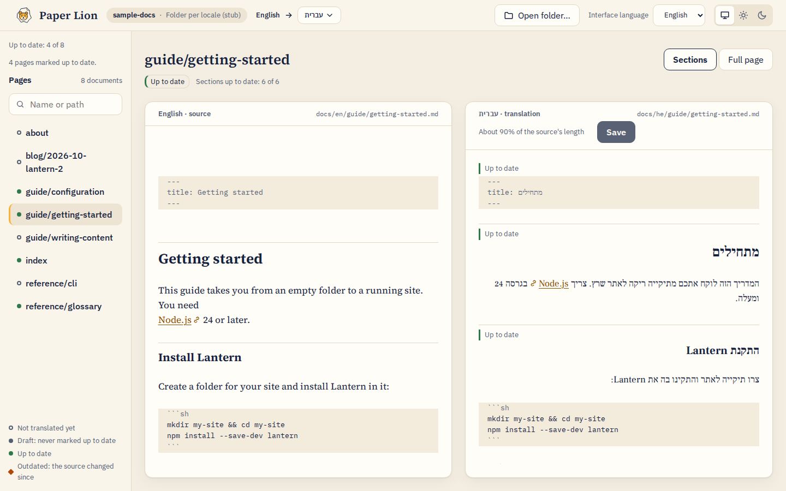
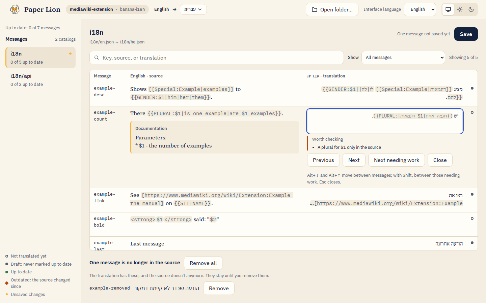
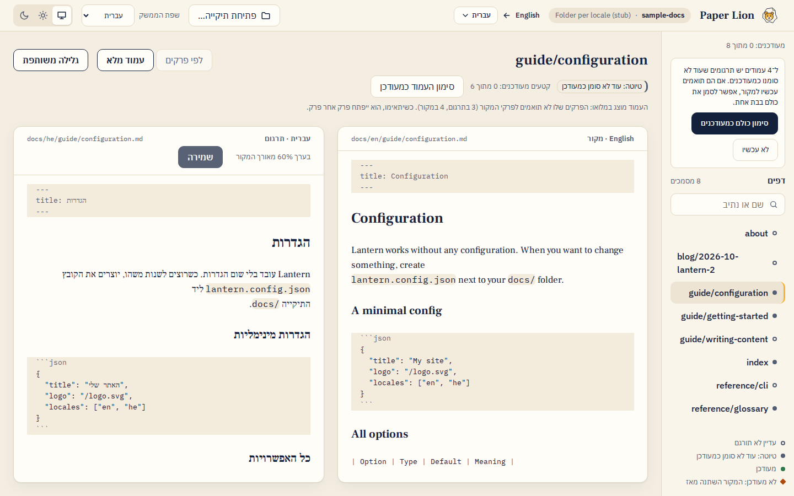

<p align="center">
  
</p>

<h1 align="center">Paper Lion</h1>

<p align="center"><strong>Localizing your pages.</strong><br>
Translate a website's docs and an app's interface side by side, right to left included.</p>

<p align="center">
  <a href="https://github.com/mooeypoo/paperl10n/actions/workflows/ci.yml"></a>
  <a href="LICENSE"></a>
  <a href="https://buymeacoffee.com/mooeypoo"></a>
</p>

<picture>
  <source media="(prefers-color-scheme: dark)" srcset="assets/readme/docs-dark.png">
  
</picture>

Paper Lion is a desktop app for translators. Open a project's folder, and it shows you what there
is to translate: each page or message in its original language next to your translation, which
ones are missing, and which ones changed since you last translated them. You write, it saves the
files back where the project keeps them, in the same format, so the project's own developers
don't have to change anything.

It runs on your computer, needs no account and no internet connection, and sends nothing
anywhere.

> **Status: early, and not downloadable yet.** Paper Lion works for documentation sites built with
> Astro Starlight or VitePress, and for interface strings in banana-i18n (MediaWiki,
> jQuery.i18n) or gettext (`.po` files). There's no installer yet: for now it runs from the
> source code (see [For developers](#for-developers)).
> Paper Lion's name is a pun: *l10n* is short for "localization", and reads as "lion".

## What it does

### Translate documentation, section by section

Docs pages open side by side, split at their headings. Each section shows whether its
translation is up to date, so on a long page you see right away which part needs you. A page
that isn't translated yet starts from a copy of the source, and you replace it as you go. Links,
code, and formatting stay exactly as they were in the file.

### Know what changed

When someone edits a page in the original language, Paper Lion marks the sections of your
translation that are now **outdated**, so you update only what changed, never the whole page
again. Your list of pages shows each one as not translated, draft, up to date, or outdated.

### Translate an app's interface

Interface strings (the buttons, menus and messages of an app) open as one searchable list:
the message, the original, your translation, and its status. Open a message to translate it,
with the developers' notes on what it means and where it appears. Paper Lion checks your
translation as you type: a missing `$1`, or a plural, gender, or link that's in the original but
not in yours, gets a gentle warning. Warnings never stop you from saving. A message with a
plural or gender shows how your translation reads for each form your language has.

<picture>
  <source media="(prefers-color-scheme: dark)" srcset="assets/readme/catalog-dark.png">
  
</picture>

### Right to left, from the start

Hebrew, Arabic, Persian and other right-to-left languages are first-class. Each side of the
screen runs in its own direction, so a Hebrew sentence with an English product name, a file
path, or a number lands the right way. Paper Lion's own interface speaks English and Hebrew,
and is built to take more languages.

<picture>
  <source media="(prefers-color-scheme: dark)" srcset="assets/readme/hebrew-dark.png">
  
</picture>

### The files stay the project's files

Paper Lion edits the same Markdown and JSON files the project already has, in the folders where
they already are, and changes nothing you didn't edit. Everything it needs to remember (which
language you translate into, which sections are up to date) is kept in small files inside the
project, so the whole team shares it through the project's usual tools.

### What's next

An installer is next. Each kind of project is a plugin, so adding one doesn't change the rest
of the app. The full plan is in the [product requirements](docs/PRD.md).

Found a problem or have an idea? [Open an issue](https://github.com/mooeypoo/paperl10n/issues).

---

## For developers

Paper Lion (`paperl10n`) is an Electron app written in TypeScript and Vue 3, built with Vite and
pnpm. The code follows strict domain-driven design with ports and adapters: each domain
(`workspace`, `document`, `catalog`, `translation`, `locale`, `formats`) keeps a pure core with no
I/O, and only adapters touch the filesystem, Electron, or parsing libraries. Lint rules and
architecture tests enforce these boundaries.

Every supported system is a **format plugin** in [`src/plugins/`](src/plugins/), written as if it
were already its own package: [`format-starlight`](src/plugins/format-starlight/README.md) for
Astro Starlight docs, [`format-vitepress`](src/plugins/format-vitepress/README.md) for VitePress
sites, [`catalog-banana`](src/plugins/catalog-banana/README.md) for banana-i18n
message files, [`catalog-gettext`](src/plugins/catalog-gettext/README.md) for gettext PO files,
and `format-stub` (a plain folder per locale). Core code never names a plugin.

The renderer is sandboxed (`contextIsolation`, no Node integration) and reaches main only through
one typed IPC contract. It never sees filesystem paths: main picks folders and hands back opaque
handles.

### Setup

You need **Node.js 24** and **pnpm**. With [nvm](https://github.com/nvm-sh/nvm), `nvm use` picks
the Node version from `.nvmrc`; `corepack enable` then provides the pnpm version pinned in
`package.json`.

```sh
git clone https://github.com/mooeypoo/paperl10n.git
cd paperl10n
nvm use
corepack enable
pnpm install        # also enables the git hooks
pnpm check          # what CI checks: types, lint, formatting, tests
pnpm dev            # run the app with hot reload
```

In the app, **Open folder…** and choose `examples/sample-docs`: a small sample docs site with
English sources and partial Hebrew translations (see its README). Edit it freely to try things
out.

More commands:

```sh
pnpm dev:harness    # the UI in a browser over the sample and fixture projects (a testing aid, ADR 0015)
pnpm test:watch     # tests, re-run on change
pnpm test:e2e       # build, then run the Electron end-to-end tests
pnpm build          # production build into out/
pnpm lint:fix       # fix what lint and SPDX headers can fix
```

**On Ubuntu 23.10+**, Electron's sandbox needs a one-time AppArmor profile:
[docs/development/linux-sandbox.md](docs/development/linux-sandbox.md). `pnpm dev` tells you when
it's missing. Never turn the sandbox off instead.

`pnpm dev` removes `ELECTRON_RUN_AS_NODE` from the environment before starting Electron. VS Code
sets it for processes its extensions start, and it would make Electron run as plain Node.

### Opening your own project

Add a `paperl10n.config.json` to the project's folder and open it. For a Starlight site:

```json
{ "sourceLocale": "en", "documentFormat": "format-starlight" }
```

Paper Lion then asks which language to translate into, and saves your choice in the same file as
`"targetLocale"` (changing nothing else in it), so everyone working on the site shares it.
banana-i18n catalogs are found from MediaWiki's `extension.json`, or by scanning the project. Each
plugin's README has its folder conventions and options.

### Where to read more

| If you want… | Read |
|---|---|
| What the product is, its glossary and milestones | [docs/PRD.md](docs/PRD.md) |
| How the code is organized, and where new code goes | [docs/architecture.md](docs/architecture.md) |
| The rules this codebase follows, for people and coding agents | [AGENTS.md](AGENTS.md) |
| The vocabulary and invariants of each domain | [docs/domains/](docs/domains/) |
| Why things were decided the way they were | [docs/adr/](docs/adr/) |
| How each milestone was planned | [docs/plan/](docs/plan/) |

## License

Paper Lion is made by [Moriel Schottlender](https://moriel.tech). Copyright © 2026 Moriel
Schottlender.

Paper Lion is free software: you can redistribute it and/or modify it under the terms of the GNU
General Public License as published by the Free Software Foundation, either version 3 of the
License, or (at your option) any later version.

Paper Lion is distributed in the hope that it will be useful, but WITHOUT ANY WARRANTY; without even
the implied warranty of MERCHANTABILITY or FITNESS FOR A PARTICULAR PURPOSE. See the
[GNU General Public License](LICENSE) for more details.

**Your translations are yours.** The license covers the Paper Lion software only. It places no
license, condition or claim on the projects you open or the translations you write with it.

The Paper Lion name and mark are **not** covered by the GPL: the mark is licensed CC BY-ND 4.0,
and forks need their own name and logo. See [assets/README.md](assets/README.md).

If Paper Lion helps you translate, you can [buy me a coffee](https://buymeacoffee.com/mooeypoo). ☕
