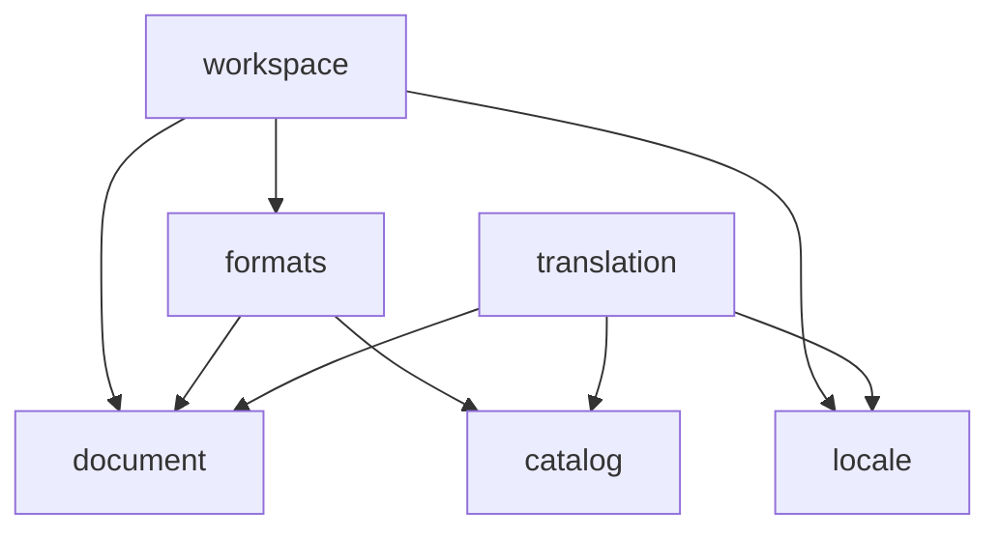

# Architecture

This is the big picture of how Paper Lion's code is organized and why, written for a newcomer's
first afternoon. The binding rules live in [`AGENTS.md`](../AGENTS.md); decisions and their
reasoning live in [`adr/`](adr/); each domain's vocabulary lives in [`domains/`](domains/).

## In one paragraph

Paper Lion is organized by **domain** (what the code is about), then by **layer** (how close it is
to the outside world). Pure business code sits in the middle and knows nothing about files,
Electron, or Vue. It declares **ports** (interfaces) for what it needs, and **adapters** implement
them. Support for each translation system (VitePress, banana-i18n, …) is a **plugin** behind a
contract, so core code never names a specific system. The Electron main process does all I/O; the
Vue UI is a replaceable adapter that talks to use cases over a typed IPC contract.

## Layers

```
            ┌──────────────────────────────────────────────┐
            │ ui/ (Vue)   main/ preload/ (Electron)        │  outside world
            ├──────────────────────────────────────────────┤
            │ app/  composition root: wires it all         │
            │ (app/node/ for Electron, ui-harness/ dev)    │
            ├──────────────────────────────────────────────┤
            │ domains/*/adapters/   plugins/*/             │  fs, libraries, systems
            ├──────────────────────────────────────────────┤
            │ domains/*/application/  use cases + ports    │  pure
            │ domains/*/domain/       model + rules        │  pure
            │ shared/kernel/          Result, ids, paths   │  pure
            └──────────────────────────────────────────────┘
                     dependencies point inward (down)
```

Pure code (`shared/kernel`, every `domain/` and `application/`, each domain's `index.ts`)
compiles without Node or DOM types, so it can't do I/O even by accident.

## Domains and their allowed dependencies

Declared once in [`scripts/domain-graph.ts`](../scripts/domain-graph.ts). Lint rules are generated
from it, and a test keeps it acyclic and in sync with `src/domains/`.



| Domain | Owns |
|---|---|
| `locale` | languages, text direction (LTR/RTL), locale metadata |
| `document` | longform Markdown documents, frontmatter, block segmentation |
| `catalog` | message catalogs, messages, `qqq` documentation, placeholder/plural validation |
| `translation` | source↔target pairing, status, source-change tracking (from M1) |
| `formats` | the format plugin contracts and their registry |
| `workspace` | opening a project, its config, discovering translatable resources |

Within a domain, `domain/` may use only `domain/` and the kernel; `application/` may also use other
domains along a declared edge, and only through their `index.ts`.

## How imports work

Across units, code imports through aliases that resolve only to entry points
([ADR 0004](adr/0004-module-entry-points.md)):

```ts
import { ok, type Result } from '#kernel/result';
import { createFormatRegistry } from '#domains/formats';
```

Relative imports (`./`, `../`) stay inside one domain, plugin, or layer. `app/` is the only place
that imports concrete adapters (`#adapters/<domain>/<file>`) and plugins.

## Processes and the IPC contract

```
┌──────────── main (Node) ───────────────┐        ┌──── renderer (sandboxed) ─────┐
│ main/index.ts    lifecycle             │        │ ui/   no Node, no Electron     │
│ main/window.ts   hardening             │        │   window.paperl10n.openProject()│
│ main/ipc.ts      sender + arg checks ◄─┼─ IPC ──┼── preload/  createApi(invoke)  │
│ app/node/        Electron root         │        └───────────────────────────────┘
│   └─ app/  createAppApi: registry,     │
│      use cases, DTO mapping, guard     │
└────────────────────────────────────────┘
```

The renderer and main share one typed contract, `#ipc-contract`: plain DTOs, error codes, and
`PaperLionApi`. The renderer never sends file paths; it gets an opaque project id
([ADR 0006](adr/0006-process-model-and-ipc.md)). `src/app/` is pure and shared by every
composition root. Electron's (`src/app/node/`) passes in the real disk and the native dialog.

The renderer also parses Markdown, so the editor sees the same blocks as the reading model: both
use the Lezer configuration in `#markdown-syntax`
([ADR 0017](adr/0017-shared-markdown-syntax.md)), the one shared unit besides the kernel and the
contract that the UI may import.

A second, development-only root is the **browser UI harness** (`src/ui-harness/`,
`pnpm dev:harness`, [ADR 0015](adr/0015-browser-ui-harness.md)): the same UI on the same
`createAppApi`, over in-memory copies of the plugin fixtures, through a transport that
structured-clones every call like IPC does. It's a testing aid, never shipped (`pnpm build`
checks), and it proves nothing about the preload, the sandbox, or the real disk.

## The plugin system

Each translation system is a **format plugin**: a self-contained folder in `src/plugins/<id>/`
with a manifest (`paperl10n-plugin.json`), an `index.ts` that exports `plugin`, its fixtures, and
its tests ([ADR 0005](adr/0005-built-in-plugins.md), [`domains/formats.md`](domains/formats.md)).

```
src/plugins/format-<x>/   ──imports──►  #plugin-api  (formats' narrow surface: contracts, Result,
        ▲                                             ProjectFiles, documentKey, …)
        │ only app/ imports plugins
src/app/plugins.ts  builtInPlugins = [formatStarlight, formatStub]
        │
        ▼
createFormatRegistry(builtInPlugins)   validates manifests, creates plugins, refuses a broken set
        │
        ▼
guarded views: every plugin call returns a Result; a throw becomes formats.plugin-failed
```

- A plugin sees the project only through `ProjectFiles` (read-only, project-relative paths). It
  never imports `fs`, Electron, a domain, or another plugin. Lint enforces it per plugin, from
  each manifest.
- `app/plugins.ts` is the only place that names a plugin. Core code asks the registry, so there's
  no `if (format === 'vitepress')` anywhere.
- Every plugin runs the shared contract kit (`describePluginContract` from `#plugin-api/testing`)
  and its own fixture tests. The plugin API's export list is frozen by a test.
- Built in: **`format-starlight`** (Astro Starlight sites, the first real system, M1) and
  **`format-stub`** (folder per locale, the reference plugin). Others (`format-vitepress`,
  `catalog-banana`, …) follow the same shape.

## Data flow: opening a project

The walking skeleton is one slice through every layer. Clicking **Open folder…**:

1. **UI** (`ui/App.vue` → `useProject`) calls `client.openProject()`. The client is the injected
   `PaperLionApi` ([ADR 0008](adr/0008-ui-state-and-injected-client.md)).
2. **Preload** (`preload/create-api.ts`) sends it on the `paperl10n:openProject` channel. Only
   contract fields cross; the renderer never sends a path.
3. **Main** (`main/ipc.ts`) checks the sender (the app's own top-level page) and the arguments.
   Anything else gets `internal.invalid-request` and never reaches the app.
4. **App** (`app/api-handlers.ts`, behind `guardApi`) calls the `openProject` use case. An
   unexpected throw becomes `internal.unexpected` ([ADR 0007](adr/0007-errors-as-values.md)).
5. **Use case** (`workspace/application/open-project.ts`):
   1. `FolderPicker.pick()`: the native dialog (adapter `dialog-folder-picker`). `null` = cancelled.
   2. `ProjectFilesOpener.open(folder)`: the disk adapter (`node-project-files`), rooted at the
      folder.
   3. Reads and validates `paperl10n.config.json` (`workspace/domain/project-config.ts`).
   4. Chooses the document format: the one pinned in the config, otherwise the best detection
      from the registry.
   5. `format.open(…)` → a layout bound to this project; the project is stored in
      `ProjectSessions` under a random, opaque id.
6. The result (a `ProjectSummary`, or a domain error) is mapped to DTOs (`app/error-dto.ts`:
   an exhaustive `switch`, so every error has a code, and every code has a UI message).
7. Back in the UI, `useProject` stores the summary and calls `listSourceDocuments({ projectId })`,
   which goes the same way to the layout's `listSourceDocuments()` and `targetPathFor()`, and
   checks which translations exist. The Pages sidebar lists them and selects the first.

## Data flow: reading a page

Selecting a page in the sidebar:

1. **UI** (`useDocumentPair`) calls `client.readDocumentPair({ projectId, key })`; only the newest
   request may update the view.
2. Preload → main's checks → app, as above.
3. **Use case** (`workspace/application/read-document-pair.ts`) finds the page among the layout's
   source documents, reads the source and the translation through `ProjectFiles` (a missing
   translation is `null`), and parses both with the **`MarkdownParser` port**
   (`#domains/document`, implemented by the lezer adapter, injected by the composition root).
4. A `ParsedDocument` is the exact text plus positions: blocks and inline spans, in UTF-16
   offsets ([`domains/document.md`](domains/document.md)). The handler maps it to plain DTOs.
5. **UI** shows each pane's text in a CodeMirror 6 editor (`ui/editor/`, from M2): read-only for
   the source, editable for the translation, always as text (never as HTML). The editor parses
   with the same dialect (`#markdown-syntax`) and styles the visible lines: syntax dimmed, code in
   mono, inline code, link destinations, and tags isolated as left-to-right runs, and code, data,
   HTML blocks, and `:::` fences taking direction line by line. It keeps the file's BOM and line
   endings for saving. The blocks and inline spans in the DTO are no longer used by the UI; they're
   the model for M3's sections ([follow-ups](plan/follow-ups.md)).

## How it's tested

| Level | What | Where |
|---|---|---|
| Domain rules, use cases | table-driven tests with in-memory fakes | next to the code (`*.test.ts`) |
| Ports | one contract suite per port, run against the fake *and* every real adapter | `domains/<domain>/testing/` |
| Plugins | the plugin contract kit + fixture tests | `src/plugins/<id>/` |
| Architecture rules | violation samples and positive controls | `tests/architecture/` |
| Every IPC method | preload → cloning → main's checks → app → use case → disk, without Electron | `tests/integration/` |
| UI | the real `mountApp` with a fake client; the harness on the real wiring (happy-dom) | `src/ui/`, `src/ui-harness/` |
| The built app | Playwright on Electron: panes, `lang`/`dir`, no Node in the renderer, sandbox, CSP | `tests/e2e/` |

[ADR 0011](adr/0011-testing-strategy.md) has the strategy. Every guard (lint rule, check script,
contract kit check) has a failing sample and a positive control, and was mutation-checked once by
hand.

## How the rules are enforced

[ADR 0003](adr/0003-boundary-enforcement.md) has the details:

1. **Types:** pure code has no Node or DOM types.
2. **Lint:** `eslint-plugin-boundaries` (generated from the domain graph), unknown files, and a
   rule against relative imports that cross units. Config: `scripts/eslint/architecture.ts`.
3. **Tests:** `tests/architecture/` lints known-bad samples and positive controls, so the rules
   can't silently stop working.

A violation looks like this, in the editor, in `pnpm lint`, in the pre-commit hook, and as an
annotation on the PR line in CI:

```
src/domains/document/domain/block.ts
  3:1  error  This import breaks the architecture rules in AGENTS.md ("Dependency rules"). …
              boundaries/dependencies
```

## Where does it go?

| You're adding… | Put it in |
|---|---|
| A rule about the model (validation, invariants) | `domains/<domain>/domain/` |
| A use case, or an interface for something external it needs (a port) | `domains/<domain>/application/` |
| The implementation of a port (fs, Electron, a library) | `domains/<domain>/adapters/` |
| A fake or a shared contract test for a port | `domains/<domain>/testing/` |
| Support for a new translation system | `src/plugins/format-<system>/` or `catalog-<system>/` |
| A small primitive needed by many domains | `shared/kernel/` (keep it tiny) |
| Markdown syntax both the reading model and the editor must see (a new block kind) | `shared/markdown-syntax/` ([ADR 0017](adr/0017-shared-markdown-syntax.md)); map its node names to the model in `document/adapters/` |
| A new renderer ↔ main call | one method in `shared/ipc-contract/` + its handler, `guardApi` entry, preload method, argument validator, and harness transport method (the compiler flags each missing one) |
| A new UI string | `ui/i18n/messages/en.json` + `qqq.json` (+ `he.json`) |
| A new domain | an ADR first, then a folder + an entry in `scripts/domain-graph.ts` |

And for the work ahead:

| Future piece | Home |
|---|---|
| VitePress layout rules | `src/plugins/format-vitepress/` (Starlight's are in `format-starlight/`) |
| Edits as text splices, frontmatter fields | `document/domain/` (+ a CST-preserving YAML library in `document/adapters/`) |
| Segmentation into sections | `document/domain/`, over the existing block model |
| Pairing by section, status (missing/draft/translated/outdated), source-change tracking | `translation/domain/` |
| Drafts and sidecar state storage | a port in `translation/application/`, an adapter in `translation/adapters/` |
| Placeholder/plural validation | `catalog/domain/`, using the plugin's `placeholders.scan` |
| Atomic file writes | a `ProjectWriter` port in `formats/application/`, an adapter beside `node-project-files` |
| File watching (external changes) | a port in `workspace/application/`, an `fs.watch` adapter |
| The locale picker and language data | `locale/` (designed first: [`plan/M1-languages.md`](plan/M1-languages.md)) |
| Editor components (CodeMirror, visual editing) | `ui/`, fed by composables ([`plan/UI-UX.md`](plan/UI-UX.md)) |

## Running, testing, linting

```sh
pnpm dev            # the app, with hot reload
pnpm dev:harness    # the UI in a browser over fixture projects (testing aid)
pnpm check          # types, lint (architecture rules included), formatting, unit tests
pnpm test:e2e       # build, then Playwright on the built Electron app
```

The README has the setup. The pre-commit hook runs the fast checks; CI runs `pnpm check`, the
build, and the end-to-end tests on `ubuntu-24.04` and `ubuntu-latest`, and then checks that they
left the checkout unchanged: tests that write (choosing a target saves the config) work on
temporary copies, never on fixtures in the repository.
