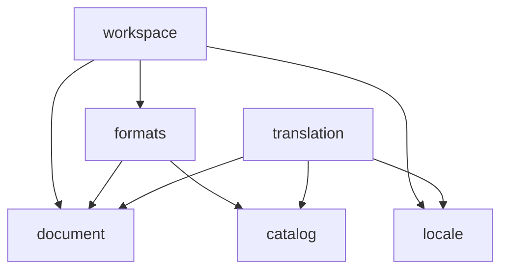

# Architecture

This is the big picture of how Paper Lion's code is organized and why. The binding rules live in
[`AGENTS.md`](../AGENTS.md); decisions and their reasoning live in [`adr/`](adr/). This document
grows during milestone M0. Sections marked *(coming in M0)* fill in as the skeleton is built.

## In one paragraph

Paper Lion is organized by **domain** (what the code is about), then by **layer** (how close it is
to the outside world). Pure business code sits in the middle and knows nothing about files,
Electron, or Vue. It declares **ports** (interfaces) for what it needs, and **adapters** implement
them. Support for each translation system (VitePress, banana-i18n, …) is a **plugin** behind a
contract, so core code never names a specific system. The Electron main process does all I/O; the
Vue UI is a replaceable adapter that talks to use cases over a typed IPC contract.

## Layers

```
            ┌──────────────────────────────────────────────┐
            │ ui/ (Vue)   main/ preload/ (Electron)        │  outside world
            ├──────────────────────────────────────────────┤
            │ app/  composition root: wires it all         │
            ├──────────────────────────────────────────────┤
            │ domains/*/adapters/   plugins/*/             │  fs, libraries, systems
            ├──────────────────────────────────────────────┤
            │ domains/*/application/  use cases + ports    │  pure
            │ domains/*/domain/       model + rules        │  pure
            │ shared/kernel/          Result, ids, paths   │  pure
            └──────────────────────────────────────────────┘
                     dependencies point inward (down)
```

Pure code (`shared/kernel`, every `domain/` and `application/`, each domain's `index.ts`)
compiles without Node or DOM types, so it can't do I/O even by accident.

## Domains and their allowed dependencies

Declared once in [`scripts/domain-graph.ts`](../scripts/domain-graph.ts). Lint rules are generated
from it, and a test keeps it acyclic and in sync with `src/domains/`.



| Domain | Owns |
|---|---|
| `locale` | languages, text direction (LTR/RTL), locale metadata |
| `document` | longform Markdown documents, frontmatter, block segmentation |
| `catalog` | message catalogs, messages, `qqq` documentation, placeholder/plural validation |
| `translation` | source↔target pairing, status, alignment (from M1) |
| `formats` | the format plugin contracts and their registry |
| `workspace` | opening a project, its config, discovering translatable resources |

Within a domain, `domain/` may use only `domain/` and the kernel; `application/` may also use other
domains along a declared edge, and only through their `index.ts`.

## How imports work

Across units, code imports through aliases that resolve only to entry points
([ADR 0004](adr/0004-module-entry-points.md)):

```ts
import { ok, type Result } from '#kernel/result';
import { createFormatRegistry } from '#domains/formats';
```

Relative imports (`./`, `../`) stay inside one domain, plugin, or layer. `app/` is the only place
that imports concrete adapters (`#adapters/<domain>/<file>`) and plugins.

## Processes and the IPC contract

```
┌──────────── main (Node) ───────────────┐        ┌──── renderer (sandboxed) ─────┐
│ main/index.ts    lifecycle             │        │ ui/   no Node, no Electron     │
│ main/window.ts   hardening             │        │   window.paperl10n.openProject()│
│ main/ipc.ts      sender + arg checks ◄─┼─ IPC ──┼── preload/  createApi(invoke)  │
│ app/node/        Electron root         │        └───────────────────────────────┘
│   └─ app/  createAppApi: registry,     │
│      use cases, DTO mapping, guard     │
└────────────────────────────────────────┘
```

The renderer and main share one typed contract, `#ipc-contract`: plain DTOs, error codes, and
`PaperLionApi`. The renderer never sends file paths; it gets an opaque project id
([ADR 0006](adr/0006-process-model-and-ipc.md)). `src/app/` is pure and shared by every
composition root. Electron's (`src/app/node/`) passes in the real disk and the native dialog.

## How the rules are enforced

[ADR 0003](adr/0003-boundary-enforcement.md) has the details:

1. **Types:** pure code has no Node or DOM types.
2. **Lint:** `eslint-plugin-boundaries` (generated from the domain graph), unknown files, and a
   rule against relative imports that cross units. Config: `scripts/eslint/architecture.ts`.
3. **Tests:** `tests/architecture/` lints known-bad samples and positive controls, so the rules
   can't silently stop working.

A violation looks like this, in the editor, in `pnpm lint`, in the pre-commit hook, and as an
annotation on the PR line in CI:

```
src/domains/document/domain/block.ts
  3:1  error  This import breaks the architecture rules in AGENTS.md ("Dependency rules"). …
              boundaries/dependencies
```

## Where does it go?

| You're adding… | Put it in |
|---|---|
| A rule about the model (validation, invariants) | `domains/<domain>/domain/` |
| A use case, or an interface for something external it needs (a port) | `domains/<domain>/application/` |
| The implementation of a port (fs, Electron, a library) | `domains/<domain>/adapters/` |
| A fake or a shared contract test for a port | `domains/<domain>/testing/` |
| Support for a new translation system | `src/plugins/format-<system>/` or `catalog-<system>/` |
| A small primitive needed by many domains | `shared/kernel/` (keep it tiny) |
| A new domain | an ADR first, then a folder + an entry in `scripts/domain-graph.ts` |

*(coming in M0: the plugin system and the data flow of the walking skeleton.)*
