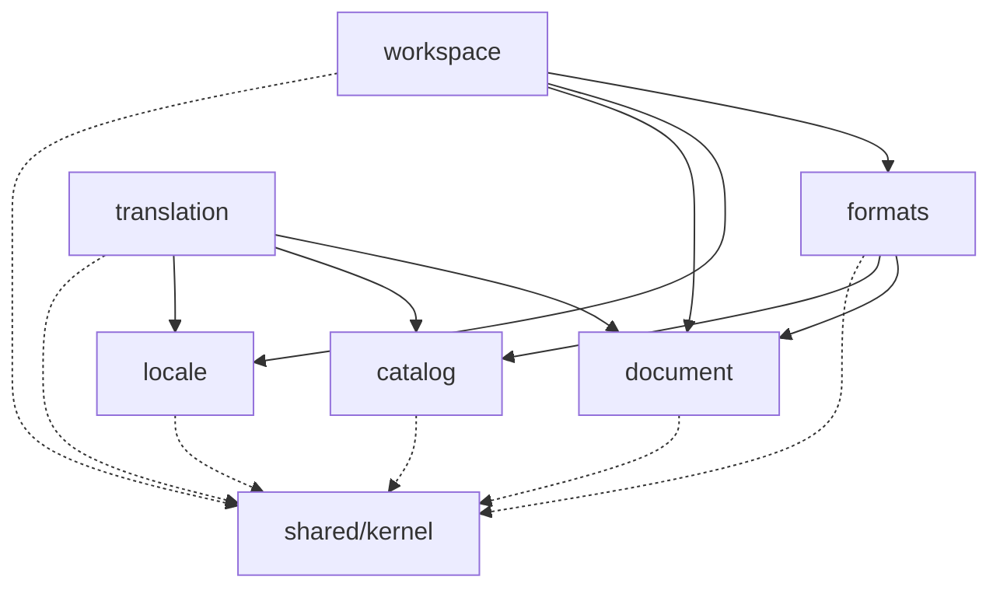

# M0 plan: the architectural skeleton

Status: **reviewed (round 1), ready to build.** The ⚑ deviations are accepted and already applied
to `AGENTS.md`. The dependency list in [§9](#9-dependencies-to-approve) is approved. Decisions from
the review are logged in [§13](#13-review-decisions-and-remaining-questions).

M0 ships no features. It ships a foundation: strict DDD domains, ports and adapters, a format-plugin
system, enforced boundaries, and one thin slice through every layer that proves the wiring works.
When M0 is done, it should be obvious where every future piece of code belongs.

Contents:
1. [Decisions at a glance](#1-decisions-at-a-glance)
2. [Repo layout](#2-repo-layout)
3. [Boundary enforcement](#3-boundary-enforcement)
4. [Electron boundary and the typed IPC contract](#4-electron-boundary-and-the-typed-ipc-contract)
5. [Plugin contracts and the registry](#5-plugin-contracts-and-the-registry)
6. [The walking skeleton](#6-the-walking-skeleton)
7. [Tooling, scripts, and CI](#7-tooling-scripts-and-ci)
8. [Requirements for the future Markdown parser and editor](#8-requirements-for-the-future-markdown-parser-and-editor)
9. [Dependencies to approve](#9-dependencies-to-approve)
10. [Docs and ADRs](#10-docs-and-adrs)
11. [License](#11-license)
12. [Ordered steps](#12-ordered-steps)
13. [Review decisions and remaining questions](#13-review-decisions-and-remaining-questions)

---

## 1. Decisions at a glance

Each row becomes an ADR. Rows marked **⚑** deviated from or added to `AGENTS.md`. All are
accepted, and `AGENTS.md` now reflects them.

| Topic | Choice | Main alternative rejected | ADR |
|---|---|---|---|
| Build tooling | **electron-vite** (one Vite config for main, preload, and renderer). Packaging deferred to a later milestone, probably electron-builder. | Electron Forge + Vite plugin: the Vite plugin has been marked experimental for a long time, and Forge adds a second config model (makers, publishers) we don't need yet. | 0002 |
| Plugin location | **⚑ Self-contained folders in the app, `src/plugins/<plugin-name>/`**, each with a **manifest** (`paperl10n-plugin.json`), its own fixtures, and imports limited to `#plugin-api`. No workspace packages yet, but extraction is a folder move. | pnpm workspace packages from day one: real isolation, but 4–5 extra `package.json`/`tsconfig` files and a split of the `formats` contract into its own package before we know its shape. | 0005 |
| Boundary enforcement | **eslint-plugin-boundaries** with a declared domain dependency graph, plus **TypeScript purity projects** (domain code compiles without Node or DOM types), plus **architecture tests** that lint known-bad samples. | dependency-cruiser: good at cycles and graphs, but a second tool with its own config language and no in-editor feedback. The declared graph prevents cycles by itself. | 0003 |
| Entry points | **⚑ Subpath imports** (`#domains/formats` → `src/domains/formats/index.ts`), so deep imports *can't resolve*. `app/` alone may import adapters directly. Each domain may have a test-only `testing/index.ts`. | `tsconfig` `paths` + a Vite alias: works, but has to be kept in sync in 3–4 places. It's the fallback if subpath imports misbehave. | 0004 |
| IPC contract | **⚑ One file, `src/shared/ipc-contract.ts`**: a typed API interface, a runtime method list, and DTOs. The renderer never sends file paths. It gets an opaque `projectId`. | Passing domain types straight over IPC: less code, but it couples the UI to domain internals and breaks "UI is swappable". | 0006 |
| Errors | **`Result<T, E>` values for expected failures**, with errors as plain objects `{ code, …params }`. Throw only for bugs. Error codes double as i18n message keys. | Exceptions everywhere: they lose their type and custom fields crossing IPC. `neverthrow`: an extra dependency and a chaining style a newcomer must learn. | 0007 |
| UI state | **Plain composables** with state created at the app root and provided through `provide/inject`. The IPC client is injected too, so tests pass a fake. | Pinia: boring and fine, but an extra dependency we don't need for two views. We revisit when several views share long-lived state. | 0008 |
| UI strings | **⚑ The app's own strings in banana-i18n format** (`en.json`, `qqq.json`, `he.json`). We dogfood the format Paper Lion will edit. | vue-i18n: heavier, and a different message syntax from the one we're building tooling for. | 0009 |
| Styling rules | **stylelint core rules** ban physical properties (`margin-left`, `text-align: right`, …) and raw colors outside `tokens.css`. | A hand-written regex script: zero dependencies, but fragile on `.vue` files. | 0010 |
| Tests | **Vitest**, tests colocated as `*.test.ts`, fixtures in `tests/fixtures/`, a reusable **plugin contract test kit**, and one **Playwright** Electron smoke test. | Jest: slower and needs a separate transform setup. Vitest reuses the Vite config. | 0011 |
| Lint/format/hooks | **ESLint (flat config) + Prettier**. Pre-commit runs from a **plain `.githooks/` script** (`core.hooksPath`). | Biome: fast, but it can't express the boundaries rules and its Vue support is partial. husky/lint-staged: dependencies for something git does natively. | 0012 |
| License headers | **One SPDX line per source file** (`SPDX-License-Identifier: GPL-3.0-or-later`), checked by a small script. Fixtures are exempt. | Full REUSE compliance (copyright line per file + the Python `reuse` tool): more churn per file, and an extra toolchain. | 0013 |

---

## 2. Repo layout

### 2.1 Plugins: folders now, extractable by design

**Decision: plugins are folders in `src/plugins/<plugin-name>/`, named exactly like their future
packages** (`format-vitepress`, `catalog-banana`), and written as if they were already packages.
They may stay built-in forever. The point is that extraction, or loading third-party plugins
someday, never requires a rewrite.

What makes a plugin folder extractable:

1. **It's self-contained.** Everything the plugin owns lives in its folder:

   ```
   src/plugins/format-stub/
   ├─ paperl10n-plugin.json   # manifest (data, §5.1)
   ├─ index.ts                # exports `plugin: PluginModule`, nothing else
   ├─ format-stub.ts          # the implementation
   ├─ format-stub.test.ts     # runs the contract kit + plugin-specific tests
   ├─ fixtures/basic/…        # sample projects, owned by the plugin
   └─ README.md               # what system it supports, layout rules, options
   ```

2. **It has exactly one dependency on the app: `#plugin-api`.** `src/domains/formats/plugin-api.ts`
   is a deliberately narrow facade. It contains the contract types (from `formats`, `document`,
   `catalog`, and the kernel) and a few pure helpers (`ok`, `err`, `projectPath`). It doesn't contain
   the registry or anything else core-only. Tests import its sibling, `#plugin-api/testing` (the
   contract test kit and the in-memory `ProjectFiles`). At extraction time, these two files become
   the `@paperl10n/plugin-api` package, and each plugin's import changes in one line.
3. **The plugin API is plain data and interfaces.** No classes to extend, no core singletons, no
   `instanceof` checks. Anything a plugin receives is passed in through `create(host)` or a
   method's arguments. That's what lets the API be published as a small standalone package.
4. **External libraries are declared.** The manifest lists the npm packages the plugin may import
   (`"externalDependencies": ["yaml"]`). `eslint.config.js` reads every manifest and allows exactly
   those imports for that plugin. So the dependency list for a future `package.json` is always
   accurate.
5. **Isolation is enforced.** Plugins can't import each other, core internals, Node, or Electron.
   Only `app/composition-root.ts` imports a plugin, and only through its `index.ts`. An architecture
   test lints a sample plugin that breaks each rule.

The trade-off for a solo maintainer:

| | Folders (recommended) | pnpm workspace packages |
|---|---|---|
| Daily cost | One `package.json`, one test run, one build | A `package.json`, `tsconfig`, and build per package; version bumps |
| Isolation | Lint-enforced (strong, guarded by architecture tests) | Enforced by the package manager |
| The hard part | Deferred, but prepared: `plugin-api.ts` is already the SDK boundary | Immediate: publishing a "plugin SDK" package before the contract has settled |
| Extraction later | Move the folder, add a `package.json` generated from the manifest, change `#plugin-api` → `@paperl10n/plugin-api` | Already done |

**Triggers to extract:** a third party wants to publish a plugin, or we add user-installed plugins.
`docs/domains/formats.md` keeps an extraction checklist.

**⚑ Accepted deviation:** the old `AGENTS.md` tree listed "site-format plugins" under a domain's
`adapters/`. Plugins now have a top-level `src/plugins/`, because they consume the `formats`
contract and aren't part of the `formats` domain. (ADR 0005)

**⚑ Accepted deviation:** `AGENTS.md` put format fixtures in `tests/fixtures/<format>/`. Plugin
fixtures now live in the plugin's own `fixtures/` folder, so the folder can move as one unit.
Fixtures for non-plugin adapters stay in `tests/fixtures/`.

### 2.2 Tree after M0

```
paperl10n/
├─ .github/
│  ├─ workflows/ci.yml
│  └─ dependabot.yml            # weekly, grouped: npm + GitHub Actions
├─ .githooks/pre-commit
├─ .editorconfig  .gitattributes  .gitignore  .nvmrc
├─ .prettierrc.json  .prettierignore
├─ AGENTS.md  CLAUDE.md  LICENSE  README.md
├─ package.json  pnpm-workspace.yaml  pnpm-lock.yaml
├─ electron.vite.config.ts  vitest.config.ts  playwright.config.ts
├─ eslint.config.js  stylelint.config.js
├─ tsconfig.json                # solution file: references only
├─ tsconfig.core.json           # kernel, ipc-contract, domain/, application/, index.ts, plugins. No Node, no DOM.
├─ tsconfig.node.json           # adapters, app, main, preload, build configs. Node + Electron types.
├─ tsconfig.web.json            # ui. DOM types, Vue.
├─ tsconfig.test.json           # *.test.ts, testing/, tests/. Node + Vitest types.
├─ scripts/
│  ├─ spdx.ts  check-spdx.ts   # header rules (pure, tested) + CLI (check and --fix)
│  └─ domain-graph.ts           # the allowed domain → domain edges (read by ESLint and a test)
├─ docs/
│  ├─ PRD.md
│  ├─ plan/M0.md  M1-languages.md      # M1-languages: discussion seed for the locale picker and data
│  ├─ architecture.md
│  ├─ domains/formats.md  workspace.md  locale.md
│  └─ adr/0001-record-architecture-decisions.md … 0013-…
├─ src/
│  ├─ shared/
│  │  ├─ kernel/                # result.ts, brand.ts, project-path.ts, locale-id.ts
│  │  └─ ipc-contract.ts        # the one typed renderer↔main API (§4)
│  ├─ domains/
│  │  ├─ locale/
│  │  │  ├─ domain/locale.ts            # Locale value object, text direction rules
│  │  │  └─ index.ts
│  │  ├─ document/
│  │  │  ├─ domain/source-document.ts   # DocumentKey, SourceDocument (M0: refs only, no parsing)
│  │  │  └─ index.ts
│  │  ├─ catalog/
│  │  │  ├─ domain/message.ts           # MessageKey, Message (types only, for the CatalogFormat sketch)
│  │  │  └─ index.ts
│  │  ├─ translation/
│  │  │  └─ index.ts                    # empty in M0, with a comment saying what will live here
│  │  ├─ formats/
│  │  │  ├─ domain/                     # format-id.ts, detection.ts, plugin-manifest.ts (parse + validate)
│  │  │  ├─ application/
│  │  │  │  ├─ ports/                    # project-files.ts, document-format.ts, catalog-format.ts, plugin-module.ts
│  │  │  │  └─ format-registry.ts
│  │  │  ├─ adapters/node-project-files.ts
│  │  │  ├─ testing/                    # in-memory-project-files.ts, document-format-contract.ts, index.ts
│  │  │  ├─ plugin-api.ts               # #plugin-api: the ONLY thing plugins import (future @paperl10n/plugin-api)
│  │  │  ├─ plugin-api-testing.ts       # #plugin-api/testing: contract kit + fakes for plugin tests
│  │  │  └─ index.ts                    # core-facing API (registry, ports)
│  │  └─ workspace/
│  │     ├─ domain/project-config.ts    # parse + validate paperl10n.config.json (pure)
│  │     ├─ application/
│  │     │  ├─ ports/                   # folder-picker.ts, project-files-opener.ts, project-sessions.ts
│  │     │  ├─ open-project.ts
│  │     │  └─ list-source-documents.ts
│  │     ├─ adapters/                   # electron-folder-picker.ts, in-memory-project-sessions.ts
│  │     ├─ testing/                    # fake-folder-picker.ts, index.ts
│  │     └─ index.ts
│  ├─ plugins/
│  │  └─ format-stub/                   # reference DocumentFormat for the skeleton (§6)
│  │     ├─ paperl10n-plugin.json       # manifest
│  │     ├─ index.ts                    # exports `plugin: PluginModule`
│  │     ├─ format-stub.ts
│  │     ├─ format-stub.test.ts
│  │     ├─ fixtures/basic/             # sample project: plugin tests, manual runs, and e2e
│  │     └─ README.md
│  ├─ app/
│  │  ├─ composition-root.ts            # builds registry, adapters, use cases
│  │  └─ api-handlers.ts                # implements PaperLionApi: use cases → DTOs
│  ├─ main/
│  │  ├─ index.ts                       # app lifecycle, userData path
│  │  ├─ window.ts                      # BrowserWindow options (security flags), navigation lock
│  │  └─ ipc.ts                         # registers handlers, validates sender + arguments
│  ├─ preload/
│  │  ├─ create-api.ts                  # pure: builds PaperLionApi from an `invoke` function (tested)
│  │  └─ index.ts                       # wires create-api to ipcRenderer + contextBridge
│  └─ ui/
│     ├─ index.html  main.ts  App.vue
│     ├─ client.ts                      # the only file that touches window.paperl10n
│     ├─ composables/use-project.ts
│     ├─ components/ProjectPanes.vue  DocumentPane.vue
│     ├─ i18n/messages/en.json  qqq.json  he.json
│     ├─ i18n/use-i18n.ts
│     └─ styles/tokens.css  base.css
└─ tests/
   ├─ fixtures/
   │  └─ project-files/                 # for the NodeProjectFiles adapter (plugin fixtures live in the plugin)
   ├─ architecture/                     # boundary-rule tests + deliberately bad samples
   └─ e2e/walking-skeleton.spec.ts
```

Unit tests sit next to the code (`open-project.test.ts` beside `open-project.ts`). Fixtures and
cross-cutting tests live in `tests/`.

### 2.3 Domain dependency graph (M0)

Declared once in `scripts/domain-graph.ts`. ESLint generates its policies from it, a test asserts it's acyclic and matches the folders, and
`docs/architecture.md` mirrors it.



`workspace` discovers resources *using* formats, so `workspace → formats`. That's why the read-only
`ProjectFiles` port lives in `formats`: plugins need it, and `formats` can't depend on `workspace`.

Note a consequence of rule 1: a domain's `domain/` layer can't import another domain, even for types.
Cross-domain composition happens in `application/`. So `workspace/domain/project-config.ts` uses
`LocaleId` from the kernel, not `Locale` from `locale`.

---

## 3. Boundary enforcement

Three layers, from cheapest to most thorough.

### 3.1 TypeScript purity projects (structural)

`tsconfig.core.json` covers `shared/`, every `domain/` and `application/` folder, every domain
`index.ts`, and `src/plugins/`. It sets `"lib": ["ES2023"]` and `"types": []`. With no `@types/node`
and no DOM lib, `import 'node:fs'`, `process.env`, or `window` **fail to type-check** in those
folders. It's a hard guarantee that costs nothing at runtime. Test files are in `tsconfig.test.json`,
because Vitest's types pull in Node globals.

### 3.2 eslint-plugin-boundaries (rules)

Element types, matched by path:

| Element | Pattern | May import |
|---|---|---|
| `kernel` | `src/shared/kernel/*` | `kernel` |
| `ipc-contract` | `src/shared/ipc-contract.ts` | `kernel` (types) |
| `domain` | `src/domains/*/domain/**` | same-domain `domain`, `kernel` |
| `application` | `src/domains/*/application/**` | same-domain `domain`/`application`, `kernel`, `domain-index` of domains along a declared edge |
| `domain-index` | `src/domains/*/index.ts` | same-domain `domain`/`application` (**not** `adapters`) |
| `adapters` | `src/domains/*/adapters/**` | same-domain anything, `kernel`, `domain-index` along an edge, **external libraries, Node, Electron** |
| `domain-testing` | `src/domains/*/testing/**` | like `adapters`, plus `vitest`. Only `*.test.ts` files may import it. |
| `plugin-api` | `src/domains/formats/plugin-api*.ts` | type-only re-exports from `formats`/`document`/`catalog`, pure helpers from `kernel`. Nothing else. |
| `plugin` | `src/plugins/*/**` | same plugin, `plugin-api` (tests: `plugin-api` testing too), and the externals its manifest lists. Not other plugins, domains, kernel directly, Node, or Electron. |
| `app` | `src/app/**` | everything except `ui`, `main`, `preload`; plugins only via their `index.ts` |
| `main` | `src/main/**` | `app`, `ipc-contract`, `kernel`, Electron, Node |
| `preload` | `src/preload/**` | `ipc-contract`, `electron` (contextBridge/ipcRenderer) |
| `ui` | `src/ui/**` | `ui`, `ipc-contract`, `kernel`, `vue`, the i18n library |

Rules used (as built in step 5, against `eslint-plugin-boundaries` v7): **`boundaries/dependencies`**
with `default: disallow`, `checkAllOrigins` (Node and npm imports are checked too) and
`checkInternals` (layers inside one domain are checked too). Its policies are **generated per domain
from `scripts/domain-graph.ts`**, and cross-domain targets must be the other domain's `index.ts`
(this replaces the deprecated `boundaries/entry-point` rule). Also **`boundaries/no-unknown-files`**,
and a small custom rule, **`paperl10n/no-relative-cross-unit-imports`**: a relative import may not
leave its domain, plugin, or layer, because crossing goes through `#` aliases (`AGENTS.md` rule 7).
Config: `scripts/eslint/architecture.ts`.

Each rule gets a custom message that points to the rule in `AGENTS.md`.

**Subpath imports make the entry-point rule structural too.** In `package.json`:

```jsonc
"imports": {
  "#kernel/*": "./src/shared/kernel/*.ts",
  "#ipc-contract": "./src/shared/ipc-contract.ts",
  "#domains/*": "./src/domains/*/index.ts",
  "#domain-testing/*": "./src/domains/*/testing/index.ts",
  "#plugin-api": "./src/domains/formats/plugin-api.ts",
  "#plugin-api/testing": "./src/domains/formats/plugin-api-testing.ts",
  "#plugins/*": "./src/plugins/*/index.ts"
}
```

`#domains/formats` resolves to the index. `#domains/formats/domain/detection` doesn't resolve at all.
TypeScript (`moduleResolution: "bundler"`), Vite, Vitest, and the ESLint resolver all read this one
place. *To verify in step 3:* TypeScript resolving `.ts` targets through `imports`. Fallback:
`tsconfig` `paths` + Vite `resolve.alias`.

**No cycles, by construction.** Cross-domain imports are only allowed along edges in
`domain-graph.ts`. A test runs a topological sort on that file, so a cycle would fail the test. Adding
an edge is a visible one-line diff, and it should come with a doc update.

**No `if (format === 'vitepress')`.** Domains can't import plugins, and `FormatId` is an opaque
branded string. Core code has nothing to compare against except values handed to it.

### 3.3 Architecture tests (guarding the guards)

`tests/architecture/boundaries.test.ts` runs ESLint's Node API (`lintText` with a virtual
`filePath`) over a list of known violations and asserts each one is reported with the expected rule.
For example: `node:fs` in `document/domain`, a deep import into `formats/application`, `ui` importing
a domain, a plugin importing `#domains/formats` instead of `#plugin-api`, a plugin importing another
plugin, a plugin importing an npm package its manifest doesn't declare, `margin-left` in a `.vue`
style. Without this, a
plugin upgrade or a config typo can disable a rule silently, and nobody notices until the architecture
has rotted.

### 3.4 How a violation shows up

**In the editor:** a red squiggle from the ESLint extension (or a type error from §3.1) as you type.

**Locally:** `pnpm lint`, and the pre-commit hook, which blocks the commit:

```
src/domains/document/domain/block.ts
  3:1  error  'document/domain' may not import 'node:fs'. Domain code is pure;
              put I/O behind a port in application/ (AGENTS.md, dependency rule 1)  boundaries/dependencies
```

**In CI:** the `lint` step fails the job. `actions/setup-node` registers ESLint and `tsc` problem
matchers, so the error also appears as an annotation on the offending line in the PR's "Files
changed" tab. *To verify in step 4.*

---

## 4. Electron boundary and the typed IPC contract

### 4.1 Process layout

```
┌──────────── main (Node) ─────────────┐        ┌──── renderer (sandboxed) ────┐
│ main/index.ts   lifecycle            │        │ ui/  Vue app                 │
│ main/window.ts  BrowserWindow        │        │   client.ts ← window.paperl10n│
│ main/ipc.ts     ipcMain.handle(...)  │◄─IPC──►│ preload/index.ts             │
│   └─ app/composition-root.ts         │ invoke │   contextBridge.expose(...)  │
│        use cases ← adapters (fs,     │        └──────────────────────────────┘
│        dialog, plugins)              │
└──────────────────────────────────────┘
```

- `contextIsolation: true`, `nodeIntegration: false`, `sandbox: true`, `webSecurity` left on.
- Navigation is locked (`will-navigate` → prevent; `setWindowOpenHandler` → deny). The
  permission request handler denies everything.
- CSP in `index.html`: strict in production (`default-src 'self'`). Dev mode is relaxed only as much
  as Vite HMR needs.
- `ipcMain` handlers check `event.senderFrame` against the app's own origin and validate arguments.
- `userData` is set explicitly to `<appData>/paperl10n`, so the identifier isn't derived from the
  display name. The window title is "Paper Lion".
- Window options come from a pure function (`createWindowOptions()`). A unit test asserts the
  security flags, so they can't regress silently.
- Sandboxed preloads must be a single bundled CommonJS file. electron-vite handles this. *To verify
  in step 11.*

### 4.2 The contract, defined once

```ts
// src/shared/ipc-contract.ts
// SPDX-License-Identifier: GPL-3.0-or-later
import type { Result } from '#kernel/result';

export interface LocaleDto { readonly id: string; readonly direction: 'ltr' | 'rtl' }

export interface ProjectSummaryDto {
  readonly projectId: string;            // opaque handle; the renderer never sees absolute paths
  readonly name: string;
  readonly sourceLocale: LocaleDto;
  readonly targetLocale: LocaleDto;
  readonly documentFormat: { readonly id: string; readonly displayName: string };
}

export interface SourceDocumentDto {
  readonly key: string;                  // locale-independent, e.g. "guide/getting-started"
  readonly sourcePath: string;           // project-relative
  readonly targetPath: string;           // project-relative; the file may not exist yet
}

export const errorCodes = [
  'workspace.config-invalid',
  'workspace.no-document-format',
  'workspace.unknown-project',
  'formats.plugin-failed',
  'files.unreadable',
  'internal.unexpected',
] as const;
export type ErrorCode = (typeof errorCodes)[number];
export interface ErrorDto { readonly code: ErrorCode; readonly params?: Readonly<Record<string, string | number>> }

/** Everything the renderer can ask of main. One method = one IPC channel. */
export interface PaperLionApi {
  /** Shows the native folder picker, then opens the project. `null` means the user cancelled. */
  openProject(): Promise<Result<ProjectSummaryDto | null, ErrorDto>>;
  listSourceDocuments(request: { readonly projectId: string }): Promise<Result<readonly SourceDocumentDto[], ErrorDto>>;
}

export const apiMethods = ['openProject', 'listSourceDocuments'] as const satisfies readonly (keyof PaperLionApi)[];
// Compile error if a method is added to PaperLionApi but not to apiMethods:
type MissingMethods = Exclude<keyof PaperLionApi, (typeof apiMethods)[number]>;
export const apiMethodsAreComplete: [MissingMethods] extends [never] ? true : never = true;

export const channelFor = (method: keyof PaperLionApi) => `paperl10n:${method}` as const;
```

Each side's use of it:

- **Preload** builds the object by mapping `apiMethods` to `ipcRenderer.invoke(channelFor(m), ...args)`
  and calls `contextBridge.exposeInMainWorld('paperl10n', api)`. This is the one documented
  `as PaperLionApi` cast in the codebase.
- **Main** (`main/ipc.ts`) takes `handlers: PaperLionApi` from the composition root and an argument
  validator per method (`{ [K in keyof PaperLionApi]: Validator<Parameters<PaperLionApi[K]>> }`).
  Because the type is mapped, a missing handler or validator is a compile error. Each handler is
  wrapped so that a thrown exception becomes `err({ code: 'internal.unexpected' })` and is logged.
  The promise never rejects across IPC.
- **Renderer** declares `window.paperl10n: PaperLionApi` once, in `ui/client.ts`, and provides it
  through `provide/inject`. Components and composables never touch `window`.

Validators are hand-written in M0 (two methods, about 10 lines). When the API grows, a schema library
is an open question (§13).

**Why DTOs instead of domain types:** the contract is the seam between processes and the seam that
makes the UI swappable. Branded types and value objects stay in main. `app/api-handlers.ts` maps
use-case results to DTOs, which is boring and explicit.

**Why opaque project handles:** the renderer never supplies a filesystem path. Main picks the folder
(native dialog), keeps the open project in a session store, and hands back a `projectId`. A
compromised renderer can't ask main to read `/etc/passwd`.

---

## 5. Plugin contracts and the registry

This is just enough shape to prove the idea. The full contract grows in M1 (VitePress), M4
(banana-i18n), and M5 (second plugins), and each change is recorded in `docs/domains/formats.md`.

### 5.1 Manifest and plugin module

A plugin is **a manifest (data) plus a module (code)**. The manifest says what the plugin is. Code
only says how it works.

```jsonc
// src/plugins/format-stub/paperl10n-plugin.json
{
  "manifestVersion": 1,
  "id": "format-stub",                         // FormatId; also the config key and the folder name
  "packageName": "@paperl10n/format-stub",     // its name if it's ever extracted
  "kind": "document",                          // "document" | "catalog"
  "apiVersion": 1,                             // plugin-api version it was written against
  "version": "0.1.0",
  "displayName": "Folder per locale (stub)",   // product name, shown as-is (not translated)
  "description": "Reference plugin: Markdown in <root>/<locale>/ folders.",
  "license": "GPL-3.0-or-later",
  "author": { "name": "Moriel", "url": "https://moriel.tech" },
  "builtIn": true,
  "capabilities": ["layout"],                  // optional features it implements, e.g. later "frontmatter-rules", "dialect"
  "externalDependencies": []                   // npm packages it may import (lint-enforced)
}
```

```ts
// formats/application/ports/plugin-module.ts
/** What a plugin's index.ts exports as `plugin`. */
export interface PluginModule {
  readonly manifest: unknown;                     // the imported JSON; validated by the registry, never trusted
  create(host: PluginHost): FormatPlugin;         // factory, so host services can be added without breaking plugins
}

/** Services the app gives plugins. Empty-ish in M0; a logger, a clock, etc. can be added here later. */
export interface PluginHost {
  readonly apiVersion: 1;
}
```

- `parsePluginManifest(unknown): Result<PluginManifest, ManifestError>` is a pure function in
  `formats/domain`. It checks required fields, the id format (`format-*` / `catalog-*`, matching
  `kind`), a supported `manifestVersion`/`apiVersion`, and known capability names. Built-in plugins
  go through the same validation a third-party plugin would.
- The registry checks that the created object's `kind` matches the manifest and that the plugin
  implements every capability it declares.
- **Why import the manifest instead of reading it from disk?** Built-ins are bundled, so
  `import manifest from './paperl10n-plugin.json'` keeps them simple. A future third-party loader
  would read the same file from disk and pass it to the same validator. Only the loading changes.
- When a plugin is extracted, its `package.json` can be generated from the manifest (`name`,
  `version`, `license`, `author`, `description`, `dependencies`). The manifest stays as the
  discoverable "this is a Paper Lion plugin" file.

M0 builds the manifest validator, the registry checks, and one real manifest (`format-stub`). A loader
for plugins from disk is explicitly **not** in M0.

### 5.2 Shared pieces

```ts
// formats/domain/format-id.ts
export type FormatId = Brand<string, 'FormatId'>;           // 'format-vitepress', 'catalog-banana'

// formats/domain/detection.ts
export type Detection =
  | { readonly matches: false }
  | { readonly matches: true; readonly confidence: 'certain' | 'likely' | 'fallback'; readonly evidence: readonly ProjectPath[] };

export type FormatError = { readonly code: 'formats.plugin-failed'; readonly formatId: FormatId; readonly reason: string };

// formats/application/ports/project-files.ts
/** Read-only view of an opened project. The only way a plugin sees the disk. */
export interface ProjectFiles {
  /** Recursive, sorted, project-relative POSIX paths. Skips .git and node_modules. PROJECT_ROOT is ''. */
  list(dir: ProjectPath, filter?: { readonly extensions?: readonly string[] }): Promise<Result<readonly ProjectPath[], FileAccessError>>;
  readText(path: ProjectPath): Promise<Result<string, FileAccessError>>;
  exists(path: ProjectPath): Promise<boolean>;
}
```

`ProjectPath` (kernel) is a branded, normalized, project-relative POSIX path. Its constructor rejects
absolute paths and `..`. `NodeProjectFiles` additionally resolves symlinks and refuses anything
that escapes the root. Plugins are pure: they get `ProjectFiles` and never import `fs`. So the same
plugin runs against an in-memory fake in unit tests and against a real fixture folder in adapter
tests.

Writing is out of scope for M0. A separate `ProjectWriter` port with atomic writes arrives in M2.
Read-only plugins can't write by construction.

### 5.3 `DocumentFormat` (longform)

A two-phase shape: `detect` is cheap, and `open` loads the system's own config once (for example,
VitePress's `locales`) and returns a bound layout. Identity (id, name, versions) lives in the
manifest, not here.

```ts
export interface DocumentFormat {
  readonly kind: 'document';

  /** Does this project look like ours? Cheap: no full-tree reads. Never throws. */
  detect(files: ProjectFiles): Promise<Detection>;

  /** Loads system config once and returns a layout bound to this project. */
  open(context: DocumentFormatContext): Promise<Result<DocumentLayout, FormatError>>;
}

export interface DocumentFormatContext {
  readonly files: ProjectFiles;
  readonly sourceLocale: LocaleId;
  readonly options: Readonly<Record<string, unknown>>;   // this plugin's section of paperl10n.config.json; the plugin validates it
}

/** Where documents live for each locale. Layout only: no Markdown parsing here. */
export interface DocumentLayout {
  /** Locales the system itself declares, if it knows (VitePress does). */
  readonly declaredLocales: readonly LocaleId[];
  listSourceDocuments(): Promise<Result<readonly SourceDocument[], FormatError>>;
  /** Pure path mapping. The target file may not exist yet. */
  targetPathFor(document: SourceDocument, target: LocaleId): Result<ProjectPath, FormatError>;

  // Planned, not in M0:
  // frontmatterRules(document): FrontmatterRules     — translatable vs keep-as-is keys (M1/M2)
  // dialect: MarkdownDialect                         — containers (::: tip), components, MDX tolerance (M1+)
}
```

`SourceDocument` (`document` domain) is `{ key: DocumentKey; path: ProjectPath; locale: LocaleId }`.
The **`DocumentKey`** is the locale-independent identity (`guide/getting-started`) that pairs a
source document with its translations. `translation` will build pairs on it. I'd like this added to the
PRD glossary.

### 5.4 `CatalogFormat` (interface strings): sketch only, no implementation in M0

```ts
export interface CatalogFormat {
  readonly kind: 'catalog';

  detect(files: ProjectFiles): Promise<Detection>;
  open(context: CatalogFormatContext): Promise<Result<CatalogLayout, FormatError>>;

  /** Text → messages, keeping what's needed to write the file back unchanged. */
  parse(text: string, location: CatalogLocation): Result<ParsedCatalog, FormatError>;
  /** Applies changes as patches to the original text. Untouched bytes stay identical. */
  serialize(original: ParsedCatalog, changes: readonly MessageChange[]): Result<string, FormatError>;

  /** Tokens that must survive translation: $1, {{PLURAL:…}}, %s, {name}. */
  readonly placeholders: { scan(text: string): readonly PlaceholderToken[] };
}

export interface CatalogLayout {
  /** e.g. i18n/en.json (messages), i18n/qqq.json (documentation), i18n/he.json (messages). */
  listCatalogs(): Promise<Result<readonly CatalogLocation[], FormatError>>;
  catalogPathFor(target: LocaleId): Result<ProjectPath, FormatError>;
}
```

`serialize(original, changes)` takes the original rather than rebuilding from scratch. That makes
the PRD's guarantee ("an edited file changes only where it was edited") the natural implementation,
not an afterthought. The same approach will apply to documents.

### 5.5 Registry

```ts
export type FormatPlugin = DocumentFormat | CatalogFormat;

/** A validated manifest paired with its created plugin. */
export interface RegisteredFormat<P extends FormatPlugin = FormatPlugin> {
  readonly manifest: PluginManifest;
  readonly plugin: P;
}

export interface FormatRegistry {
  readonly documentFormats: readonly RegisteredFormat<DocumentFormat>[];
  readonly catalogFormats: readonly RegisteredFormat<CatalogFormat>[];
  find(id: FormatId): RegisteredFormat | undefined;
  /** Runs every plugin's detect(); returns matches ranked by confidence, then id. */
  detect(files: ProjectFiles): Promise<readonly { readonly format: RegisteredFormat; readonly detection: Detection }[]>;
}

/** Validates each manifest, creates each plugin, and fails on duplicate ids, unsupported versions,
 *  kind mismatches, or missing capabilities. */
export function createFormatRegistry(modules: readonly PluginModule[], host: PluginHost): Result<FormatRegistry, RegistryError>;
```

- The registry wraps every plugin call, so a plugin that throws or rejects produces
  `formats.plugin-failed` and doesn't crash the app. That matters once third-party plugins exist.
- **The only place plugins are named** is `app/composition-root.ts`:
  `import { plugin as formatStub } from '#plugins/format-stub'` → `createFormatRegistry([formatStub], host)`.
- *Choosing* a format (config pin beats detection, a single `certain` match beats `likely`, …) is
  workspace policy, so it lives in the `openProject` use case, not in the registry.

### 5.6 Plugin contract test kit

`#plugin-api/testing` exports
`describePluginContract(pluginModule, { fixtureRoot, sourceLocale, expected })`. Every plugin's test
file calls it. It checks the invariants every plugin must hold:

- the manifest validates, its `id` matches the folder name, and `packageName` is `@paperl10n/<id>`
- the plugin implements every capability its manifest declares
- `detect` is deterministic and doesn't throw on an empty project
- `listSourceDocuments` returns a stable order, unique keys, and paths that exist
- `targetPathFor(doc, sourceLocale)` equals `doc.path` (the mapping round-trips)
- a target path never equals a source path for another locale
- plugin options it doesn't understand produce an error, not a crash

M2 adds parse → serialize round-trip checks here, and M4 adds a catalog version. A new plugin gets the
whole suite for free, which is most of what "a new format = an adapter + fixtures" needs in practice.

---

## 6. The walking skeleton

### 6.1 The slice

> Open a folder → `format-stub` lists the Markdown files → a use case returns them → the Vue UI
> shows a source pane and a target pane, each with `lang`/`dir` from its locale.

1. **UI**: `App.vue` shows an "Open folder…" button (string from `en.json`). `useProject().open()`
   calls `client.openProject()`.
2. **Preload → main**: `invoke('paperl10n:openProject')`. `main/ipc.ts` checks the sender, then calls
   `handlers.openProject()`.
3. **App**: `api-handlers.ts` calls the `openProject` use case and maps the result to
   `ProjectSummaryDto`. The locale DTO's `direction` comes from the `locale` domain. **The UI never
   decides direction.**
4. **Use case `workspace/openProject`**:
   - asks the `FolderPicker` port for a folder (`ElectronFolderPicker` → `dialog.showOpenDialog`).
     Cancel → `ok(null)`.
   - opens it through the `ProjectFilesOpener` port. The composition root implements it with a small
     function wrapping `NodeProjectFiles`.
   - reads and validates `paperl10n.config.json` (pure parser in `workspace/domain`).
   - picks the document format: the config pin if present, else the registry's best detection
     (else `workspace.no-document-format`).
   - calls `format.open(context)` → `DocumentLayout`.
   - stores the open project in `ProjectSessions` and returns the summary.
5. **Use case `workspace/listSourceDocuments(projectId)`**: looks up the session, then calls
   `layout.listSourceDocuments()` and `layout.targetPathFor(doc, targetLocale)` for each document.
6. **UI**: `ProjectPanes.vue` renders two `DocumentPane`s. Each pane is a
   `<section :lang="locale.id" :dir="locale.direction">` with a heading and a list of paths. Paths
   are wrapped in `<bdi>`, because a file name isn't prose in the pane's language. That's the
   convention we'll need everywhere identifiers sit inside RTL text. The app chrome's own `lang`/`dir`
   come from the UI locale. The pane locales are separate.

**`format-stub`** is deliberately simple: a folder-per-locale layout, with sources at
`<root>/<sourceLocale>/**/*.md`, targets at `<root>/<targetLocale>/<same key>`, and an option
`root` (default: project root). It detects with `fallback` confidence when a source-locale folder
contains `.md` files. It's the reference implementation for plugin authors. Whether to keep it after M1
will be revisited when it becomes relevant (pros and cons of keeping vs. removing).

**Config v0** (`paperl10n.config.json`, everything except `targetLocale` optional):

```json
{
  "sourceLocale": "en",
  "targetLocale": "he",
  "documentFormat": "format-stub",
  "formatOptions": { "format-stub": { "root": "" } }
}
```

M0 requires `targetLocale` in the config. Picking locales in the UI (PRD §7.1) comes early in M1,
after a dedicated design discussion about the picker and where language data comes from. See
[`M1-languages.md`](M1-languages.md). To keep that open, M0's `locale` domain is deliberately
minimal: a `localeFrom(id)` function over a small RTL table, which can later be backed by a real
language-data source without changing its callers.

**Fixture** `src/plugins/format-stub/fixtures/basic/`:

```
paperl10n.config.json        en → he
en/index.md
en/guide/getting-started.md
he/index.md                  real Hebrew text (already translated)
notes.txt                    not Markdown: ignored
node_modules/pkg/README.md   must be skipped (needs a .gitignore negation)
```

### 6.2 Tests at each level

| Level | File | What it proves |
|---|---|---|
| Kernel | `shared/kernel/project-path.test.ts` | rejects `..`, absolute paths (including drive letters), backslashes, and control characters; normalizes `./a//b/` → `a/b`; the root is `''` |
| Kernel | `shared/kernel/result.test.ts`, `locale-id.test.ts` | `ok`/`err` narrowing (type-level with `expectTypeOf`); locale ids are validated and canonicalized (`he-il` → `he-IL`) |
| Domain | `formats/domain/plugin-manifest.test.ts` | each required field missing; a bad id prefix; a kind/id mismatch; unsupported `manifestVersion`/`apiVersion`; an unknown capability; extra fields are ignored, not trusted |
| Plugin API | `formats/plugin-api.test.ts` | **the exact list of exported names** (a deliberate change to the plugin surface has to update this test); type-level checks that a minimal plugin compiles against it |
| Port contract | `formats/testing/project-files-contract.ts` | one suite of `ProjectFiles` behaviors, run against **both** `InMemoryProjectFiles` and `NodeProjectFiles`, so the fake can't drift from the real adapter |
| Port contract | `workspace/testing/project-sessions-contract.ts` | the same idea for `ProjectSessions` (in-memory adapter now, any future persistent one later) |
| Domain | `locale/domain/locale.test.ts` | `he`, `ar`, `fa`, `ur`, `yi`, `he-IL`, `az-Arab` → rtl; `en`, `pt-BR`, `az-Latn` → ltr; malformed ids → error. A small explicit table, not `Intl` (deterministic across Node and Chromium). |
| Domain | `workspace/domain/project-config.test.ts` | valid config, missing `targetLocale`, bad JSON, unknown keys (warn, don't fail), invalid locale ids |
| Application | `formats/application/format-registry.test.ts` | duplicate ids, unsupported `apiVersion`, ranking, a throwing plugin → `formats.plugin-failed` |
| Application | `workspace/application/open-project.test.ts` | with `InMemoryProjectFiles`, `FakeFolderPicker`, and fake plugins: cancel → `null`; the config pin wins over detection; no match → error; an invalid config → error |
| Application | `workspace/application/list-source-documents.test.ts` | unknown project → error; target paths computed per document |
| Adapter (fixture) | `formats/adapters/node-project-files.test.ts` | against `tests/fixtures/project-files/`: sorted listing, skips `.git`/`node_modules`, refuses symlink escapes, decodes UTF-8 with BOM correctly |
| Adapter (fixture) | `plugins/format-stub/format-stub.test.ts` | runs the contract kit (§5.6) plus exact expectations against its own `fixtures/basic/` through the **real** `NodeProjectFiles` |
| App | `app/api-handlers.test.ts` | the composition root with a fake picker pointed at the fixture: the full use case → DTO mapping, error codes preserved |
| IPC contract | `shared/ipc-contract.test.ts` | `apiMethods` matches `PaperLionApi` (type-level); channel names are unique and prefixed; every `ErrorCode` is a valid i18n key |
| Main | `main/window.test.ts`, `main/ipc.test.ts` | security flags; every API method is registered with a validator; an untrusted sender is rejected; bad arguments → error result; a thrown exception → `internal.unexpected` |
| Preload | `preload/create-api.test.ts` | the preload's logic is a pure `createApi(invoke)`; with a fake `invoke`, each method calls the right channel with the right arguments |
| UI | `ui/composables/use-project.test.ts` | with a fake client: the loading → loaded and loading → error transitions; cancel leaves state unchanged; a stale response doesn't overwrite a newer one |
| UI | `ui/components/ProjectPanes.test.ts` | with a fake client: the target pane has `dir="rtl" lang="he"`, the source pane `dir="ltr" lang="en"`; an error code renders its `en.json` message |
| UI | `ui/i18n/messages.test.ts` | every `ErrorCode` and every key in `en.json` has a `qqq.json` entry; `he.json` has no keys missing from `en.json` |
| Architecture | `tests/architecture/*.test.ts` | the boundary violations from §3.3 are reported; `domain-graph.ts` is acyclic |
| E2E | `tests/e2e/walking-skeleton.spec.ts` | Playwright launches the built app, stubs `dialog.showOpenDialog` to return the fixture path, clicks "Open folder…", and asserts both lists and both panes' `dir`/`lang`. Also fails on CSP violations in the console. |

Budget: the whole Vitest suite in **under 5 seconds** locally. The e2e test runs separately.

### 6.3 Testing standards (apply to every step, not just the skeleton)

The seams between parts (ports, the plugin API, the IPC contract) are where a solo project breaks
silently, so they get the most deliberate tests.

1. **Every port has a contract suite.** A shared `describe<Port>Contract(makeImplementation)` in
   the domain's `testing/` folder states the port's behavior once. It runs against the in-memory
   fake *and* every real adapter. Use-case tests can then trust the fakes.
2. **The plugin API is tested from both sides.** The plugin contract kit (§5.6) checks plugins
   against the API. `plugin-api.test.ts` freezes the API's export list and types, so changing what
   plugins see is always a visible, deliberate diff (and a reason to bump `apiVersion`).
3. **Every plugin** runs the contract kit, plus its own fixture tests with exact expected output,
   through the real `NodeProjectFiles`. From M2 on it also runs round-trip tests.
4. **Every IPC method** is covered end to end without Electron: preload `createApi` → (fake
   transport) → `main/ipc.ts` validation → `api-handlers` → use cases with fakes. Type-level tests
   make a missing handler, validator, or method-list entry a compile error.
5. **Every use case** tests its success path and each error code it can return.
6. **Every domain rule** (parsers, validators, value objects) gets table-driven tests, including
   malformed input.
7. **Architecture rules** each have a failing sample (§3.3).
8. **UI tests** check behavior and attributes (`lang`, `dir`, text from message keys), not markup
   snapshots.
9. **Tests are deterministic and fast:** no network, no real dialogs, no sleeps. Temp directories
   are created and cleaned up by the test.
10. **A step isn't done until its new code meets 1–9.** Each step's "Verify" includes its tests.

**Coverage** (`@vitest/coverage-v8`, approved): report coverage in CI, with a floor
for pure code (`shared/`, `domain/`, `application/`, plugins) of about 90% lines and branches. UI and
Electron glue are excluded from the floor and covered by the tests above and e2e. The floor is a
safety net, not the goal. Points 1–10 are the goal.

---

## 7. Tooling, scripts, and CI

### 7.1 Runtime and package manager

- **Node 24 LTS** in `.nvmrc` and `engines` (`"node": ">=24"`). Locally: `nvm use` picks it up
  from `.nvmrc`. Electron ships its own Node for runtime code; this one is for tooling and CI.
- `"packageManager": "pnpm@12.14.0"` (your local version) so Corepack and CI agree.
- `pnpm-workspace.yaml` exists even with one package, because pnpm reads its settings from there.
  Most importantly, it lists the dependencies allowed to run install scripts: `electron` (downloads its
  binary) and `esbuild`. pnpm blocks build scripts by default.

### 7.2 Scripts

```jsonc
{
  "dev": "electron-vite dev",
  "build": "electron-vite build",
  "preview": "electron-vite preview",
  "typecheck": "vue-tsc --build",
  "lint": "eslint . --cache && stylelint \"src/**/*.{css,vue}\" --cache && node scripts/check-spdx.ts",
  "lint:fix": "eslint . --cache --fix && stylelint \"src/**/*.{css,vue}\" --fix && node scripts/check-spdx.ts --fix",
  "format": "prettier --write .",
  "format:check": "prettier --check .",
  "test": "vitest run",
  "test:watch": "vitest",
  "test:e2e": "electron-vite build && playwright test",
  "check": "pnpm typecheck && pnpm lint && pnpm format:check && pnpm test",
  "prepare": "git config core.hooksPath .githooks"
}
```

`pnpm check` is the one command that means "green". CI runs the same thing.

### 7.3 TypeScript

`strict: true` plus `noUncheckedIndexedAccess`, `exactOptionalPropertyTypes`,
`noImplicitOverride`, and `verbatimModuleSyntax`. Project references (§2.2) give us the purity
check (§3.1) and incremental builds. `vue-tsc --build` type-checks the whole solution, including
`.vue` files. Lint uses `typescript-eslint`'s `strictTypeChecked` preset, which bans `any`, floating
promises, and throwing non-`Error`s, and `eslint-plugin-vue`'s recommended rules.
`eslint-config-prettier` turns off anything Prettier owns.

### 7.4 Vitest

One `vitest.config.ts` with two projects: `node` (everything except `src/ui`) and `ui` (`src/ui`,
`happy-dom` environment, Vue plugin). Tests import `describe/it/expect` explicitly (no globals),
which keeps pure code free of ambient test types.

### 7.5 Git hooks

`.githooks/pre-commit` (a shell script, no dependency) runs `eslint --cache`, `stylelint --cache`,
`prettier --check`, and the SPDX check on staged files, then `vue-tsc --build` (incremental, so
fast). Tests run in CI, not on every commit. `pnpm install` sets `core.hooksPath` via `prepare`.
Skipping the hook with `--no-verify` remains possible. CI is the real gate.

### 7.6 GitHub Actions (`.github/workflows/ci.yml`)

```yaml
on: { push: { branches: [main] }, pull_request: {} }
permissions: { contents: read }
concurrency: { group: ci-${{ github.ref }}, cancel-in-progress: true }
jobs:
  check:              # ubuntu-latest
    steps: checkout → pnpm/action-setup → setup-node (node-version-file: .nvmrc, cache: pnpm)
           → pnpm install --frozen-lockfile → pnpm typecheck → pnpm lint → pnpm format:check
           → pnpm test → pnpm build
  e2e:                # ubuntu-latest, needs: check
    steps: … → pnpm exec playwright install-deps? (only what Electron needs) → xvfb-run -a pnpm test:e2e
```

Separate steps (rather than one `pnpm check`) so the failing step's name tells you what broke. M0
runs Linux only. A macOS/Windows matrix arrives with packaging. `dependabot.yml` opens weekly,
grouped update PRs for npm and Actions. It's built into GitHub, so no dependency.

---

## 8. Requirements for the future Markdown parser and editor

We don't choose them in M0. These are the requirements they must meet, and the skeleton decisions that
keep the choice open.

### 8.1 Markdown parser (M1/M2)

- **Lossless round trip.** For an unedited document, `serialize(parse(text)) === text`, byte for
  byte: whitespace, list markers (`-` vs `*`), emphasis style, reference links, HTML blocks, CRLF,
  BOM, trailing newline, and tabs. In practice this means **edits are applied as text splices at
  source offsets**, never by re-printing an AST.
- **Source positions on every block**: start and end offsets in **UTF-16 code units** (the unit
  the editor will use), plus line and column. Blocks are the unit of alignment and of splicing.
- **Stable block segmentation**: re-parsing an unchanged region yields the same blocks in the same
  order, so alignment and cursor sync don't jitter while typing.
- **Frontmatter preserved exactly**: YAML with comments, key order, and quoting kept (a
  CST/Document-style YAML API, not parse-and-dump). TOML (`+++`) tolerated.
- **Dialect extensibility** declared by plugins: VitePress containers (`::: tip`), `[[toc]]`, Vue
  components in Markdown; Starlight asides (`:::note`); **MDX tolerance** (Starlight supports `.mdx`):
  treat JSX and ESM as opaque, preserved blocks. GFM tables, footnotes, and math.
- **BiDi-neutral**: preserves U+200E/U+200F and U+2066–U+2069 exactly; no normalization.
- **Pure and portable**: runs without Node APIs, so it works behind a port from main or, later, a
  worker.
- **Performance**: parsing a typical page takes milliseconds. Listing 1,000 pages must not require
  parsing them (status will use hashes).
- **License compatible with GPL-3.0-or-later** (MIT, BSD, ISC, Apache-2.0 are all fine).

*Kept open by:* `document` will own its own `Block` model and a `MarkdownParser` **port**. The library
sits in `document/adapters/`, mapped to our model, so swapping it touches one folder. Offsets use a
kernel `TextRange` type from day one.

### 8.2 Editor component (M2/M3)

- **Source editing first** (raw Markdown with syntax highlighting); preview is a separate toggle.
- **Real BiDi editing**: a base direction per pane and per line or paragraph (`dir=auto` style),
  correct visual caret movement and selection across mixed-direction runs, and **bidi isolation of
  Markdown syntax** so `**`, `[`, `](`, and list markers don't visually jump in RTL lines.
- **IME** support (Hebrew, Arabic, CJK input methods).
- **An API for synchronization**: map offset ↔ screen position, scroll to an offset, read the visible
  range, set the selection, and decorate ranges (misaligned-block highlights).
- **Read-only mode** for the source pane.
- **Large documents** stay fast (viewport rendering).
- **Framework-agnostic** (not tied to Vue), so it can be wrapped in `ui/` and survive a UI swap.
- **Works under a strict CSP** in a sandboxed renderer (no `eval`; nonce support for injected
  styles).
- **Accessible**: screen-reader and keyboard friendly.
- **Themeable through our CSS tokens.**
- GPL-compatible license.

*Kept open by:* a `ui/components/` wrapper with a small props/events contract (`modelValue`, `lang`,
`dir`, `readonly`, `scrollToOffset`, `visibleRange`). The panes in M0 already set `lang`/`dir` at the
container level, where the editor will be mounted.

---

## 9. Dependencies to approve

**Approved** (review round 1), including the optional `banana-i18n` and Playwright. All are
well-established. Versions get pinned to
the current stable major at install time and recorded in the lockfile.

| Package | Kind | Why | Step |
|---|---|---|---|
| `typescript` | dev | the language | 2 |
| `vitest` | dev | tests, reusing the Vite config | 2 |
| `@types/node` | dev | types for the node project only | 2 |
| `eslint`, `@eslint/js`, `typescript-eslint` | dev | linting, strict type-aware rules | 3 |
| `prettier`, `eslint-config-prettier` | dev | formatting, without lint conflicts | 3 |
| `eslint-plugin-boundaries` | dev | architecture rules | 5 |
| `eslint-import-resolver-typescript` | dev | lets the boundaries plugin resolve TS and `#` imports | 5 |
| `electron` | dev | the runtime (packagers bundle it, so it's a dev dependency) | 11 |
| `electron-vite`, `vite` | dev | dev server and builds for all three processes | 11 |
| `vue` | **runtime** | UI | 11 |
| `@vitejs/plugin-vue` | dev | SFC compilation | 11 |
| `vue-tsc` | dev | type-checking `.vue` | 11 |
| `eslint-plugin-vue` | dev | Vue lint rules | 13 |
| `stylelint`, `postcss-html` | dev | logical-CSS and token rules, including inside `.vue` | 13 |
| `banana-i18n` | **runtime** | UI string formatting (`$1`, `{{PLURAL}}`). Tiny, no dependencies, from Wikimedia. | 13 |
| `@vue/test-utils`, `happy-dom` | dev | component tests | 14 |
| `@playwright/test` | dev | Electron smoke test. | 15 |
| `@vitest/coverage-v8` | dev | coverage report and floor for pure code (§6.3). Approved in review round 3. | 4 |

**Total:** 2 runtime and about 20 dev dependencies. Deliberately absent: Pinia, a schema library,
husky/lint-staged, dependency-cruiser, a CSS framework, and a packaging tool (all deferred or not
needed).

---

## 10. Docs and ADRs

### 10.1 Docs

- **`docs/architecture.md`**: the big picture, written for a newcomer's first afternoon:
  - the layers diagram, the domain graph (§2.3), and the process diagram (§4.1)
  - the data flow of the walking skeleton, step by step (§6.1)
  - **"Where does it go?"**, a table that answers the question for upcoming work:

    | Future piece | Home |
    |---|---|
    | VitePress / Starlight layout rules | `src/plugins/format-vitepress/`, `format-starlight/` |
    | Markdown parser library | `document/adapters/`, behind a `MarkdownParser` port |
    | Block model, segmentation | `document/domain/` |
    | Pairing, status (missing/draft/translated/outdated), alignment | `translation/domain/` |
    | Drafts and sidecar state storage | a port in `translation/application/`, an adapter in `translation/adapters/` |
    | Placeholder/plural validation | `catalog/domain/`, using the plugin's `placeholders.scan` |
    | Atomic file writes | a `ProjectWriter` port in `formats/application/`, an adapter beside `NodeProjectFiles` |
    | File watching (external changes) | a port in `workspace/application/`, a chokidar-free `fs.watch` adapter |
    | A new renderer ↔ main call | one method in `ipc-contract.ts` + handler + validator (compiler enforces all three) |
    | A new UI string | `ui/i18n/messages/en.json` + `qqq.json` |
    | A new domain | an ADR first, then a folder + an edge in `domain-graph.ts` |
  - how to run, test, and lint (a short version of the README)
- **`docs/domains/formats.md`**: ubiquitous language (format, layout, detection, document key,
  catalog location, placeholder token), the contracts from §5 as they're actually built, invariants
  (plugins are pure, never throw, paths are `ProjectPath`s, round-trip), how to write a plugin
  (with `format-stub` as the walkthrough), the contract test kit, versioning (`apiVersion`), and the
  extraction-to-package checklist.
- **`docs/domains/workspace.md`** and **`docs/domains/locale.md`**: short, covering terms, invariants,
  and config v0. Created in the same step as their code.
- **`README.md`**: what Paper Lion is, status, dev quick start, license notice, and credit.

### 10.2 ADRs

A light MADR-style format: *Status · Context · Decision · Alternatives · Consequences*, under one page
each.

| # | Title | Step |
|---|---|---|
| 0001 | Record architecture decisions | 1 |
| 0002 | Build tooling: electron-vite | 11 |
| 0003 | Boundary enforcement: boundaries plugin + purity projects + architecture tests | 5 |
| 0004 | ⚑ Module entry points: subpath imports, adapters visible only to `app/`, `testing/` entry | 5 |
| 0005 | ⚑ Built-in plugins as self-contained folders with a manifest and `#plugin-api` | 7 |
| 0006 | ⚑ Electron process model and the typed IPC contract | 12 |
| 0007 | Errors as values: `Result` and coded errors | 2 |
| 0008 | UI state with composables and an injected client | 14 |
| 0009 | ⚑ UI strings in banana-i18n format | 13 |
| 0010 | Styling: tokens and logical properties enforced by stylelint | 13 |
| 0011 | Testing strategy: Vitest projects, fixtures, plugin contract kit, e2e smoke | 9 |
| 0012 | Lint, format, and git hooks without hook managers | 3 |
| 0013 | License GPL-3.0-or-later and SPDX headers | 1 |
| 0014 | TypeScript version policy: 6.0 now, 7-ready, switch on a clear trigger | 2 |

The ⚑ decisions are accepted, and `AGENTS.md` was updated during review (plugin location and
self-containment, manifest, `#plugin-api`, entry points, IPC contract location, plugin fixtures,
SPDX). The ADRs written during M0 record the reasoning behind rules that are already in place.

---

## 11. License

- **`LICENSE`**: the GPLv3 text, downloaded verbatim from `https://www.gnu.org/licenses/gpl-3.0.txt`.
  It's unmodified. The "or later" is expressed by the notices, not by editing the license text.
- **`package.json`**: `"license": "GPL-3.0-or-later"`,
  `"author": { "name": "Moriel", "url": "https://moriel.tech" }`, `"private": true`. If plugin
  packages appear later, each gets the same fields.
- **README**: a "License" section with the standard GPL notice ("…either version 3 of the License, or
  (at your option) any later version…") and "Created by [Moriel](https://moriel.tech)".
- **SPDX headers: yes, one line per source file**, at the top:
  - `.ts`/`.js`/`.mjs`: `// SPDX-License-Identifier: GPL-3.0-or-later`
  - `.vue`/`.html`: `<!-- SPDX-License-Identifier: GPL-3.0-or-later -->`
  - `.css`: `/* SPDX-License-Identifier: GPL-3.0-or-later */`

  Why: it's machine-readable, survives files being copied out of the repo, and costs one line.
  No per-file copyright line: authorship lives in the README, `LICENSE`, and git history, which avoids
  churn. **Exempt:** `tests/fixtures/**` and `src/plugins/*/fixtures/**` (they stand in for users' projects, and headers would break
  byte-exact round-trip tests), JSON files (no comment syntax), and `LICENSE`. `scripts/check-spdx.ts`
  checks this in `pnpm lint` and adds missing headers with `--fix`.
- **Later** (not M0): an About screen showing the license notice. GPLv3 §5(d) asks interactive
  programs to display "Appropriate Legal Notices".

---

## 12. Ordered steps

Each step is one commit (or a very small series), leaves `pnpm check` green from step 3 on, and lists
how it's verified. Commit messages follow `area: summary` (e.g. `formats: add registry`).

### Step 0: Baseline (partly done during review)
- ✅ `docs/prd.md` renamed to `docs/PRD.md`. ✅ `AGENTS.md` updated with the accepted decisions.
  ✅ `docs/plan/M1-languages.md` added. Remaining: commit these together with this plan.
- **Verify:** `git status` clean; `AGENTS.md` links resolve.

### Step 1: License, README, and repo hygiene
- `LICENSE` (verbatim gnu.org text), `README.md` (description, status "pre-alpha", license notice,
  credit), `.editorconfig`, `.gitignore` (with negations for `node_modules` inside fixture folders),
  `.gitattributes` (`* text=auto eol=lf`, and **`-text` on `tests/fixtures/**` and
  `src/plugins/*/fixtures/**`** so git never rewrites fixture bytes), `.nvmrc` (`24`).
- ADR 0001 (with the template), ADR 0013.
- **Verify:** `diff <(curl -fsSL https://www.gnu.org/licenses/gpl-3.0.txt) LICENSE` is empty; the
  README renders on GitHub with a working link.

### Step 2: Package, TypeScript projects, Vitest, kernel
- `package.json` (metadata, `packageManager`, `engines`, `imports`), `pnpm-workspace.yaml`, the four
  tsconfigs + solution, `vitest.config.ts` (node project only for now).
- `shared/kernel`: `result.ts`, `brand.ts`, `project-path.ts`, `locale-id.ts`, with tests.
- ADR 0007 (Result and errors).
- **Verify:** `pnpm typecheck` and `pnpm test` pass. Purity check by hand: adding `import 'node:fs'`
  to a kernel file makes `pnpm typecheck` fail. (Automated in step 5.)
- *Done-notes:*
  - **TypeScript is pinned to `~6.0`**, with a documented path to 7: see
    [ADR 0014](../adr/0014-typescript-version-policy.md) (the trigger and the switch checklist live
    there). `@types/node` is pinned to `^24` to match Node 24.
  - A shared `tsconfig.base.json` holds the common compiler options. `tsconfig.node.json` and
    `tsconfig.web.json` are added in steps 11 and 13, when they have files (an empty project is a
    build error). `pnpm-workspace.yaml` moves to step 11, where `electron` first needs an
    install-script allowlist.
  - `typecheck` is `tsc --build` until `.vue` files exist (step 13 switches it to `vue-tsc --build`).
  - Test files are type-checked by `pnpm typecheck` (`tsconfig.test.json`), so `expectTypeOf`
    assertions are enforced without Vitest's separate typecheck mode.

### Step 3: Lint, format, SPDX, and hooks
- `eslint.config.js` (typescript-eslint strict, Prettier compat), `.prettierrc.json`,
  `.prettierignore` (fixtures, lockfile), `scripts/check-spdx.ts`, `.githooks/pre-commit`, `prepare`
  script, and `pnpm check`.
- ADR 0012.
- **Verify:** `pnpm check` passes; a file without a header fails `pnpm lint`, and `lint:fix` adds the
  header; a commit with a lint error is blocked by the hook.
- *Done-notes:*
  - ESLint 10 (flat config), typescript-eslint 8.72 (`strictTypeChecked`), Prettier 3.9.
  - Repo scripts are **TypeScript run natively by Node 24** (`scripts/check-spdx.ts` + the pure,
    unit-tested `scripts/spdx.ts`). `tsconfig.node.json` was created here for them.
  - Markdown is excluded from Prettier (see ADR 0012). The SPDX check runs before ESLint, so
    `lint:fix` always adds missing headers.
  - Verified by hand: a floating promise fails lint; a missing header fails lint and `lint:fix`
    adds it; a commit with a lint error is blocked by the hook.

### Step 4: CI
- `.github/workflows/ci.yml`: the `check` job (with a coverage report from `@vitest/coverage-v8`
  and the §6.3 floor for pure code), plus the non-blocking **`ts7-preview`** job from ADR 0014
  (pinned TypeScript 7 via `pnpm dlx` over the plain-TS projects). `.github/dependabot.yml`, with
  `typescript` majors ignored until ADR 0014's trigger.
- **Verify:** push a branch; CI is green. A throwaway commit with a lint error shows an inline
  annotation on the PR (this also confirms the problem matcher claim in §3.4), then gets reverted.
- *Done-notes:*
  - Actions pinned to current majors: `actions/checkout@v7`, `actions/setup-node@v7`,
    `pnpm/action-setup@v6`. Coverage runs as `pnpm test:coverage` (floor: 90% on pure code; the
    text report lists only files that aren't fully covered).
  - Verified: PR #1 green on both jobs (~20 s each). Throwaway PR #2 with a floating promise failed
    the Check job, and the error was annotated at `src/shared/kernel/zz-annotation-probe.ts:8`
    via `setup-node`'s ESLint problem matcher. The PR was closed and its branch deleted.
  - The Check job runs on a matrix of `ubuntu-24.04` (the maintainer's OS) and `ubuntu-latest`
    (moving to Ubuntu 26), both blocking. The TypeScript 7 preview runs on `ubuntu-24.04` only.
    Step 15's e2e job uses the same matrix.

### Step 5: Domain scaffolding and boundary enforcement
- Create every domain folder with its `index.ts` (`translation` empty with a pointer comment),
  `scripts/domain-graph.ts`, the boundaries config with custom messages,
  `eslint-import-resolver-typescript`, and `tests/architecture/` (violation samples + acyclic test).
- Start `docs/architecture.md` (layers, graph, rules) and write ADRs 0003 and 0004.
- **Verify:** each sample in `tests/architecture/` is reported with the expected rule; `pnpm lint` on
  the real tree is clean; a deep import `#domains/formats/domain/x` fails to resolve.
- *Done-notes:*
  - `eslint-plugin-boundaries` 7.3 uses a new policy API. Policies are generated per domain from
    `scripts/domain-graph.ts` (explicit, no templates). "Only through `index.ts`" is part of the
    `dependencies` rule, since `boundaries/entry-point` is deprecated in v7.
  - Added `paperl10n/no-relative-cross-unit-imports` (custom rule, `scripts/eslint/`) for
    `AGENTS.md` rule 7, with `RuleTester` tests. Boundaries checks *what* is imported, and this rule
    checks *how* (aliases, not `../../`).
  - `pnpm-workspace.yaml` arrived early: pnpm 12 blocks dependency install scripts, so
    `unrs-resolver` (used by the TS import resolver) is **denied** there. Its script is only a
    fallback binary download, and the resolver works without it.
  - Architecture tests: 13 violation samples + 7 positive controls + 1 type-aware sample. A mutation
    check (turning off `checkAllOrigins`; adding a graph edge) made them fail as expected.
  - Verified by hand: `#domains/formats/domain/x` fails with TS2307; a relative deep import is
    reported by both rules; a stray file outside the layer folders fails ESLint's project service.
  - **Samples that need real target files are added in the steps that create them:** deep import
    into another domain's internals and `index.ts` re-exporting adapters (step 7/8); plugin
    isolation samples (step 9); preload importing `electron` (step 11); `.vue` samples (step 13).

### Step 6: `locale` domain
- `Locale` value object, `localeFrom(id): Result<Locale, …>`, and an explicit RTL table
  (script subtags take priority over the language).
- `docs/domains/locale.md`.
- **Verify:** domain tests (§6.2).
- *Done-notes:*
  - `localeFrom(id: LocaleId): Locale` can't fail (the id is already validated by the kernel), so
    it returns a `Locale`, not a `Result`. `parseLocale(raw): Result<Locale, InvalidLocaleId>` is
    the convenience for raw input such as config files.
  - The RTL tables (12 scripts, 21 languages, including the deprecated `iw`/`ji`) are documented as
    a placeholder until M1's language-data decision.
  - `src/domains/locale/index.test.ts` freezes the domain's export list, the same pattern the plugin
    API will use.

### Step 7: `document`/`catalog` types, `formats` contracts, and the registry
- `DocumentKey`, `SourceDocument`, `Message` (types); `FormatId`, `Detection`, `ProjectFiles`,
  `DocumentFormat`, `DocumentLayout`, `CatalogFormat` (sketch); `PluginManifest` +
  `parsePluginManifest`; `PluginModule`/`PluginHost`; `createFormatRegistry` with manifest checks
  and call-guarding; `formats/testing/in-memory-project-files.ts`; and `plugin-api.ts` (the narrow
  plugin surface).
- `docs/domains/formats.md` (first version, including the manifest fields and the extraction
  checklist) and ADR 0005.
- **Verify:** manifest tests (missing fields, a bad id prefix, a kind/id mismatch, an unsupported
  version, an unknown capability); registry tests (duplicates, a kind mismatch with the manifest, a
  declared capability that isn't implemented, a throwing plugin); a type-level test that a minimal
  fake plugin satisfies each interface.

### Step 8: `NodeProjectFiles` adapter
- The fs implementation (listing, ignore list, UTF-8 + BOM, symlink/escape checks) and
  `tests/fixtures/project-files/` (including a symlink that points outside the fixture, created by
  the test in a temp dir so the repo stays portable).
- `formats/testing/project-files-contract.ts`, run against both `InMemoryProjectFiles` and
  `NodeProjectFiles`.
- **Verify:** the `ProjectFiles` contract suite passes for both implementations; adapter fixture
  tests pass; the lint sample proving a domain can't import the adapter still fails as expected.

### Step 9: `format-stub` plugin and the contract test kit
- `formats/testing/document-format-contract.ts` exposed as `#plugin-api/testing`; the full
  `src/plugins/format-stub/` folder (manifest, `index.ts`, implementation, tests, `fixtures/basic/`,
  README); the ESLint rule that reads each manifest's `externalDependencies`; and plugin
  architecture samples (imports another plugin, imports `#domains/formats`, imports an undeclared
  npm package).
- ADR 0011.
- **Verify:** `format-stub.test.ts` passes the contract kit through the real `NodeProjectFiles`;
  each plugin architecture sample is reported. **Extraction drill:** copy the folder to a scratch
  directory and confirm `grep` finds no import other than `#plugin-api` (and `#plugin-api/testing`
  in tests) and no relative path that leaves the folder.

### Step 10: `workspace` domain and use cases
- `project-config.ts` (pure parse + validate), ports (`FolderPicker`, `ProjectFilesOpener`,
  `ProjectSessions`), `openProject`, `listSourceDocuments`, `InMemoryProjectSessions`,
  `workspace/testing` fakes, and `docs/domains/workspace.md`.
- **Verify:** application tests (§6.2), all with in-memory fakes, no fs.

### Step 11: Electron shell
- `electron.vite.config.ts` (renderer root `src/ui`), `main/index.ts`, `main/window.ts` (security
  flags, navigation lock, permission handler, userData path, title "Paper Lion"), a stub
  `preload/index.ts`, and a minimal `ui/` that renders "Paper Lion". CSP meta.
- ADR 0002.
- **Verify:** `pnpm dev` opens a window; `pnpm build` passes; `main/window.test.ts` asserts the flags;
  DevTools shows `typeof require === 'undefined'` and `typeof process === 'undefined'` in the renderer.
  The sandboxed preload loads with no console errors.

### Step 12: Typed IPC contract and composition root
- `shared/ipc-contract.ts`, the real preload, `main/ipc.ts` (sender + argument validation,
  exception wrapping), `app/composition-root.ts`, `app/api-handlers.ts`, and the
  `ElectronFolderPicker` adapter.
- ADR 0006.
- **Verify:** `api-handlers.test.ts` and `ipc.test.ts`; deleting a method from `apiMethods` or a
  handler from `api-handlers.ts` produces a **type error** (checked by hand, recorded in the ADR);
  in `pnpm dev`, `await window.paperl10n.openProject()` in DevTools opens the dialog and returns a
  summary for the fixture.

### Step 13: UI foundation: tokens, logical CSS, i18n
- `styles/tokens.css` (color, spacing, type scale; light and dark via `prefers-color-scheme`),
  `base.css`, `stylelint.config.js` (physical properties and values banned, `color-no-hex` outside
  tokens), `eslint-plugin-vue`, `i18n/messages/{en,qqq,he}.json`, `use-i18n.ts`, and the `<html lang
  dir>` binding.
- ADRs 0009 and 0010.
- **Verify:** architecture samples for `margin-left` and a hex color fail stylelint;
  `messages.test.ts`; switching the UI locale to `he` in dev mirrors the chrome with no CSS changes.

### Step 14: Walking-skeleton UI
- `ui/client.ts` (inject key + `window.paperl10n`), `use-project.ts`, `ProjectPanes.vue`,
  `DocumentPane.vue`, and error rendering via error-code messages.
- ADR 0008.
- **Verify:** UI component tests with a fake client. Manually, in `pnpm dev`: open
  `src/plugins/format-stub/fixtures/basic` and see two English sources in the source pane (ltr) and their
  `he/` target paths in the target pane (rtl, mirrored layout); cancelling the dialog changes nothing;
  opening an empty folder shows the "no document format" message.

### Step 15: End-to-end smoke test
- `playwright.config.ts`, `tests/e2e/walking-skeleton.spec.ts`, and the `e2e` CI job (xvfb, on the
  same `ubuntu-24.04` + `ubuntu-latest` matrix as Check).
- **Verify:** `pnpm test:e2e` passes locally; the CI `e2e` job is green.

### Step 16: Docs pass
- Finish `docs/architecture.md` (data flow, "where does it go?" table), complete the README dev
  section, update `docs/domains/formats.md` to match what was built, and check `AGENTS.md` still
  matches the code (it was updated up front during review). Add `DocumentKey` to the PRD glossary.
- **Verify:** a cold read: following only the README, a fresh clone gets to a running app and green
  `pnpm check`. All doc links resolve.

**M0 is done when:** CI is green on `main` with both jobs; every boundary rule has a failing sample in
`tests/architecture/`; the skeleton runs from `pnpm dev`; and the 13 ADRs are accepted.

---

## 13. Review decisions and remaining questions

### 13.1 Decided in review round 1

| # | Question | Decision |
|---|---|---|
| 1 | Dependencies (§9) | Approved, including `banana-i18n` and Playwright. |
| 2 | Plugin location | `src/plugins/<name>/`, **self-contained with a manifest** and `#plugin-api` as the only app import (§2.1, §5.1). They may stay built-in forever, but extraction must never need a rewrite. |
| 3 | Entry points | Accepted: subpath imports, `app/` imports adapters, `testing/` entries. Applied to `AGENTS.md`. |
| 4 | IPC contract home | Accepted: `src/shared/ipc-contract.ts`. Applied to `AGENTS.md`. |
| 5 | Node version | **Node 24 LTS** (`.nvmrc`; run `nvm use`). |
| 6 | App id | **`io.github.mooeypoo.paperl10n`**, since the documentation site will be on GitHub Pages. Used at packaging time (see 13.2). |
| 7 | SPDX | One-line license identifier per source file. Applied to `AGENTS.md`. |
| 8 | Empty domains | Create `translation` (empty) and `catalog` (types only) in M0. |
| 9 | `format-stub` after M1 | Revisit when relevant, with pros and cons of keeping vs. removing. |
| 10 | Locale choice | Config-only in M0. The picker and language data get their own design discussion before M1 implementation: [`M1-languages.md`](M1-languages.md). |
| 11 | DCO sign-off | Wait and see. Reconsider if and when outside contributions arrive (see 13.2). |
| 12 | PRD filename | Renamed to `docs/PRD.md`. |

### 13.2 Notes on two answers

**App id: website or GitHub username?** The reverse-DNS style does come from Java. It's now the
convention for macOS bundle ids, Flatpak/Flathub ids, and Linux desktop files. Electron uses it for
the Windows app id too. The rule is to use a namespace you control that will stay stable, because
changing it after release orphans settings, keychain entries, and store listings.
- `tech.moriel.paperl10n`: tied to your website. Flathub verifies it with a file under
  `moriel.tech/.well-known/`. It stays valid as long as you keep the domain.
- `io.github.mooeypoo.paperl10n`: Flathub's standard form for GitHub-hosted projects, verified
  through your GitHub account. It stays valid as long as you keep that username.

**Chosen: `io.github.mooeypoo.paperl10n`**, because the documentation site will be on GitHub
Pages. Nothing in M0 depends on it. It's used at packaging time.

**DCO sign-off, explained.** The Developer Certificate of Origin is a short statement that a
contributor has the right to submit their code under the project's license. Contributors agree to it
by adding a `Signed-off-by: Name <email>` line to each commit (`git commit -s`). It's about the
*provenance* of outside contributions. It doesn't give you rights to relicense; that would need a
CLA, which I don't recommend for a small GPL project. (My earlier wording implied otherwise. Sorry.)
As the sole author, you don't need it: you hold the copyright to your own code. **When the first
outside contribution arrives**, add a short `CONTRIBUTING.md` saying contributions are accepted
under GPL-3.0-or-later, and optionally require DCO sign-off then. Nothing to do in M0.

### 13.3 Still open

None blocking M0. Questions to bring back later:
- `format-stub`'s future (keep vs. remove), once `format-vitepress` exists.
- The locale picker and language data design ([`M1-languages.md`](M1-languages.md)), before M1.
